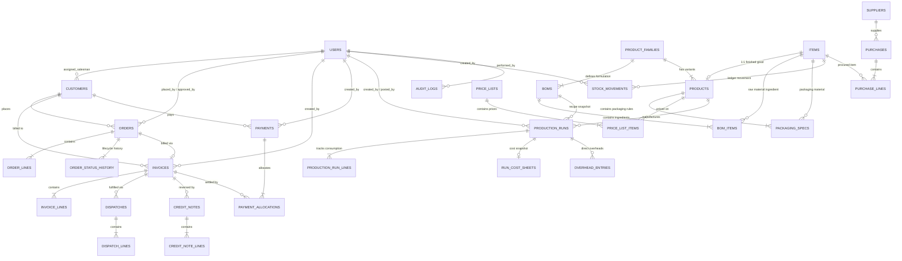

# Order-to-Audit: Technical Code Walkthrough & Interview Guide

This document is a factual, comprehensive technical reference for the **Order-to-Audit** food manufacturing platform. Every section cites concrete files, database tables, and functions verified against the repository source code.

---

## 1. BIG PICTURE

### What the System Does
Order-to-Audit is an enterprise operations and accounting platform designed for an Indian batch food manufacturing business (specifically traditional snack production such as Murukku). It tracks raw material procurement, batch manufacturing runs, field sales booking, Available-to-Promise (ATP) stock reservations, statutory GST invoicing, dispatch decrement, payment collection, customer dues ageing, and product margin analysis.

The system replaces mutable inventory columns and ad-hoc spreadsheets with an append-only, mathematically reconciled stock ledger and an immutable audit trail.

### The Five Roles
The system enforces strict Role-Based Access Control (RBAC) across five operational personas defined in [user.py](file:///home/revanth/cdi_intenship_project/backend/app/models/user.py#L9-L15) and seeded in [seed.py](file:///home/revanth/cdi_intenship_project/backend/scripts/seed.py#L37-L86):

1. **Owner (`OWNER`)**: Executive leadership. Holds access to executive KPIs, the 30-day sales trend, product commercial margins, production variance alerts, customer receivables ageing, and system telemetry.
2. **Admin (`ADMIN`)**: Factory operations manager. Holds write permissions across master data, user accounts, company tax settings, purchase orders, production runs, sales order approval/rejection, invoice dispatch, credit notes, and payment reversal.
3. **Production Supervisor (`PRODUCTION`)**: Plant floor operator. Manages recipes (BOMs), creates and logs draft production runs, records ingredient and packaging consumption, logs batch wastage, posts finished goods batches, and enters direct shift overheads (labour and fuel).
4. **Accountant (`ACCOUNTANT`)**: Financial controller. Reviews approved sales orders, issues immutable statutory GST tax invoices (under 16-character fiscal limits), generates PDF tax documents, registers customer payment receipts, executes FIFO or targeted payment allocations, reviews customer ageing statements, and monitors audit logs.
5. **Salesman (`SALESMAN`)**: Mobile field agent. Assigned to specific customer accounts (e.g. Salesman A for Retailer A in Madurai; Salesman B for Distributor B in Bengaluru). Books field orders on a mobile web interface with offline IndexedDB queueing, client UUID idempotency, and automated background sync.

### How the Two Loops Meet at Finished-Goods Stock
The business operates via two distinct, asynchronous physical operational loops that intersect exclusively at **Finished-Goods Inventory**:

```
                       [ RAW MATERIALS & PACKAGING ]
                                     │
                     Purchases (PO-*)│
                                     ▼
                      [ Inbound Stock Movements ]
                                     │
                                     │ (PRODUCTION_ISSUE)
                                     ▼
                         ┌───────────────────────┐
   PRODUCTION LOOP       │    PRODUCTION RUN     │
   (Plant Floor)         │ (Batch Recipe Scaling)│
                         └───────────────────────┘
                                     │
                                     │ (PRODUCTION_OUTPUT)
                                     ▼
 ══════════════════════ [ FINISHED GOODS STOCK ] ══════════════════════
                         (e.g., Murukku 200 g)
                         ▲                   │
       Available-to-     │                   │
       Promise (ATP)     │                   │ (DISPATCH)
       Verification      │                   ▼
                         │       ┌───────────────────────┐
                         │       │      SALES ORDER      │
   SALES & AUDIT LOOP    └───────┤  (Field Mobile App)   │
   (Commercial Desk)             └───────────────────────┘
                                             │
                                  Approved & │ Invoiced
                                             ▼
                                 [ GST TAX INVOICE ]
                                 (INV/YYYY-YY/XXXX)
                                             │
                                             ▼
                                  [ CASH & RECEIVABLES ]
                                  (Payments & Ageing)
```

1. **The Production Loop (Supply)**:
   - Raw materials (flour, oil, spices) and packaging (pouches, cartons) are received into stock via Purchases (`PURCHASE` movements).
   - A batch run is scheduled for a pack size variant (e.g., Murukku 200 g) based on a product family recipe Bill of Materials (BOM).
   - When the production run is posted, ingredients and pouches are decremented from stock (`PRODUCTION_ISSUE` movements), while marketable good units increment finished goods inventory (`PRODUCTION_OUTPUT` movement).
   - This increases the finished goods ledger balance.

2. **The Sales & Audit Loop (Demand)**:
   - A field salesman captures an order on a mobile phone from an assigned customer.
   - The order enters `SUBMITTED` status. It does **not** deduct physical inventory immediately.
   - When Admin reviews the order, the system calculates **Available-to-Promise (ATP)**:
     $$\text{ATP} = \text{Finished Goods Stock} - \sum \text{Approved/Invoiced Unfulfilled Orders}$$
   - If stock is sufficient, Admin approves the order (`APPROVED`), atomically reserving ATP stock.
   - Accountant generates a statutory GST Tax Invoice (`INVOICED`).
   - When the shipping truck departs, Admin posts a Dispatch (`DISPATCHED`).
   - The dispatch executes a negative `DISPATCH` stock movement on the finished goods item in the ledger, reducing physical inventory and releasing the order's ATP reservation with zero double-counting.
   - Accountant records payment, allocates money against open invoices, and monitors customer ageing.

### Repository Map (Top-Level Folders)
- [backend/](file:///home/revanth/cdi_intenship_project/backend): FastAPI application, SQLAlchemy models, Alembic migrations, business services, and Pytest test suite.
- [frontend/](file:///home/revanth/cdi_intenship_project/frontend): React 18, TypeScript, Vite, TanStack Query, Tailwind CSS, and IndexedDB offline salesman mobile web application.
- [scripts/](file:///home/revanth/cdi_intenship_project/scripts): Standalone orchestration scripts for Section 5 benchmark execution, demo state generation, and volume seeding.
- [docs/](file:///home/revanth/cdi_intenship_project/docs): System architecture notes, manual field-test guides, and technical reference documentation.

---

## 2. HOW A REQUEST FLOWS

To understand the architecture end-to-end, follow a single real request: **Salesman A submits a new sales order of 20 packets of Murukku 200 g for Retailer A**.

```
[1. React UI]
SalesmanOrderPage.tsx ──> saveToOutbox(IndexedDB)
        │
        ▼
[2. API Client]
syncEngine.ts / client.ts (fetch with Bearer JWT & X-Request-ID)
        │
        ▼ HTTP POST /api/v1/orders
[3. HTTP Middleware]
main.py: audit_context_middleware (Captures IP and X-Request-ID in contextvars)
        │
        ▼
[4. Router Layer]
routers/orders.py: create_order()
        │
        ▼
[5. Security Dependency]
core/deps.py: require_roles(SALESMAN, ADMIN) -> get_current_user() -> security.py: decode_access_token()
        │
        ▼
[6. Service Layer]
services/orders.py: create_order()
  ├─ 1. Check client_uuid idempotency
  ├─ 2. Check customer territory assignment
  ├─ 3. Lock sequence & generate order_no (ORD-2026-0001)
  ├─ 4. Lookup price from PriceListItem (Rs 50.00 / 5000 paise)
  ├─ 5. Calculate GST estimate via utils/gst.py
  └─ 6. Call services/audit.py: log_audit()
        │
        ▼
[7. Persistence / Model Layer]
models/order.py: Order, OrderLine, OrderStatusHistory
        │
        ▼
[8. Database Layer]
PostgreSQL: INSERT into orders, order_lines, order_status_history, audit_logs
```

### Layer-by-Layer Verification

1. **Browser / UI Layer**:
   - File: [SalesmanOrderPage.tsx](file:///home/revanth/cdi_intenship_project/frontend/src/features/salesman/SalesmanOrderPage.tsx#L200-L248)
   - Function: `handleSubmitOrder`
   - Action: The salesman chooses Retailer A, sets quantity `20`, and clicks "Submit order". The UI creates a client UUID via `crypto.randomUUID()`. It persists the record into IndexedDB store `outbox` via `saveToOutbox()` in [db.ts](file:///home/revanth/cdi_intenship_project/frontend/src/lib/offline/db.ts#L48-L51) before any network call.

2. **API Client Layer**:
   - File: [syncEngine.ts](file:///home/revanth/cdi_intenship_project/frontend/src/lib/offline/syncEngine.ts#L53-L117) and [client.ts](file:///home/revanth/cdi_intenship_project/frontend/src/lib/api/client.ts#L157-L236)
   - Function: `sendOrderToServer` / `request`
   - Action: Checks `getAccessToken()`. Attaches `Authorization: Bearer <token>` and `Content-Type: application/json`. Issues an HTTP `POST /api/v1/orders` request with `{ client_uuid, customer_id: 1, lines: [...] }`.

3. **HTTP Server & Context Middleware**:
   - File: [main.py](file:///home/revanth/cdi_intenship_project/backend/app/main.py#L33-L53)
   - Function: `audit_context_middleware`
   - Action: Intercepts the request, extracts or generates `X-Request-ID` and incoming client IP (`X-Forwarded-For` or `request.client.host`), and binds them to `contextvars` (`current_request_id`, `current_ip_address`) so subsequent audit logs automatically record caller metadata without passing request objects.

4. **Router Layer**:
   - File: [orders.py](file:///home/revanth/cdi_intenship_project/backend/app/routers/orders.py#L34-L47)
   - Function: `create_order`
   - Action: FastAPI matches route `@router.post("", response_model=OrderResponse)`. It executes endpoint dependencies: `get_db` for SQLAlchemy session, and `ALLOW_CREATE` for role validation.

5. **Security & Dependency Check**:
   - File: [deps.py](file:///home/revanth/cdi_intenship_project/backend/app/core/deps.py#L14-L68) and [security.py](file:///home/revanth/cdi_intenship_project/backend/app/core/security.py#L98-L108)
   - Functions: `require_roles`, `get_current_user`, `decode_access_token`
   - Action: `decode_access_token` verifies the JWT signature against `settings.SECRET_KEY` and checks expiry. `get_current_user` loads the user from database table `users` and ensures `user.is_active == True`. `require_roles(UserRole.SALESMAN, UserRole.ADMIN)` verifies `current_user.role in [SALESMAN, ADMIN]`. If the role was `ACCOUNTANT`, it immediately raises `HTTP 403 Forbidden`.

6. **Service Layer**:
   - File: [orders.py](file:///home/revanth/cdi_intenship_project/backend/app/services/orders.py#L244-L351)
   - Function: `create_order`
   - Action:
     - **Idempotency check**: Queries `Order` by `client_uuid`. If already present, returns existing order with `is_duplicate = True` (router returns HTTP 200 instead of HTTP 201).
     - **Salesman territory check**: Verifies `customer.assigned_salesman_id == salesman.id`. If another salesman attempts to order for this customer, raises `HTTP 403 Forbidden`.
     - **Price lookup**: Calls `get_effective_product_price()`. Completely ignores any price sent by the client. Retrieves Rs 50.00 (5,000 paise) from active `PriceListItem`.
     - **Numbering sequence**: Calls `get_next_order_number()`, acquiring a row write lock (`with_for_update()`) on `numbering_sequences` to issue the next gapless number (e.g. `ORD-2026-0001`).
     - **Audit trail**: Calls `log_audit()` in [audit.py](file:///home/revanth/cdi_intenship_project/backend/app/services/audit.py#L16-L57) to append an immutable record of `ORDER_CREATED`.

7. **Model & Database Layer**:
   - Files: [order.py](file:///home/revanth/cdi_intenship_project/backend/app/models/order.py#L38-L145) and [audit.py](file:///home/revanth/cdi_intenship_project/backend/app/models/audit.py#L10-L45)
   - Action: SQLAlchemy stages inserts into tables `orders`, `order_lines`, `order_status_history`, and `audit_logs`. `db.commit()` executes the SQL transaction in PostgreSQL. The committed entities are serialized to Pydantic schema `OrderResponse` ([order.py](file:///home/revanth/cdi_intenship_project/backend/app/schemas/order.py#L74-L95)) and returned with `HTTP 201 Created`.

---

## 3. MODULE-BY-MODULE EXPLANATION

### 1. Authentication and Roles
- **Purpose**: Authenticates users using cryptographically signed JSON Web Tokens (JWT). Enforces role-based permissions across every API route, ensuring users access only features permitted for their role. In the frontend, intercepts expired sessions, halts requests, and handles seamless re-authentication. Provides pre-configured demo logins for evaluation.
- **Files & Functions Involved**:
  - [backend/app/core/security.py](file:///home/revanth/cdi_intenship_project/backend/app/core/security.py): `verify_password`, `get_password_hash`, `create_access_token`, `create_refresh_token`, `decode_access_token`.
  - [backend/app/core/deps.py](file:///home/revanth/cdi_intenship_project/backend/app/core/deps.py): `get_current_user`, `require_roles`.
  - [backend/app/core/permissions.py](file:///home/revanth/cdi_intenship_project/backend/app/core/permissions.py): `RESOURCE_PERMISSIONS` dictionary.
  - [backend/app/routers/auth.py](file:///home/revanth/cdi_intenship_project/backend/app/routers/auth.py): `login_for_access_token` (`POST /auth/login`), `refresh_access_token` (`POST /auth/refresh`), `read_users_me` (`GET /auth/me`).
  - [frontend/src/lib/api/client.ts](file:///home/revanth/cdi_intenship_project/frontend/src/lib/api/client.ts): `setAccessToken`, `getAccessToken`, `tryRefreshSession`, `request`, `cancelInFlightRequests`.
  - [frontend/src/features/auth/AuthContext.tsx](file:///home/revanth/cdi_intenship_project/frontend/src/features/auth/AuthContext.tsx): `AuthProvider`, `useAuth`, `login`, `logout`.
  - [frontend/src/features/auth/RoleGuard.tsx](file:///home/revanth/cdi_intenship_project/frontend/src/features/auth/RoleGuard.tsx): `RoleGuard`.
  - [frontend/src/features/auth/LoginPage.tsx](file:///home/revanth/cdi_intenship_project/frontend/src/features/auth/LoginPage.tsx): `LoginPage` (includes demo accounts quick-fill buttons).
- **What Each Function Does**:
  - `create_access_token`: Encodes user ID (`sub`), role, and expiration into an HMAC-SHA256 JWT.
  - `decode_access_token`: Validates JWT signature and expiration timestamp.
  - `require_roles`: Higher-order dependency factory returning a FastAPI dependency that checks if `user.role` is in `allowed_roles`, raising HTTP 403 on failure.
  - `request` (frontend client): Injects Bearer token. On HTTP 401, attempts a single refresh via `tryRefreshSession()`. If refresh fails, cancels all pending in-flight requests via `AbortController`, clears stored tokens, and invokes `onUnauthorizedHandler` to redirect to login.
- **Inter-Module Communication**: Feeds authenticated user identity to `audit_context_middleware` and transaction logging in all other services.

### 2. Masters
- **Purpose**: Defines foundational reference entities: raw materials, packaging supplies, commercial finished goods, customer registries, suppliers, recipes (BOMs), and price lists. Decouples culinary formulations from commercial packaging sizes so multi-pack variants share the same recipe.
- **Files & Functions Involved**:
  - [backend/app/models/item.py](file:///home/revanth/cdi_intenship_project/backend/app/models/item.py): `Item`, `ItemType`.
  - [backend/app/models/product.py](file:///home/revanth/cdi_intenship_project/backend/app/models/product.py): `ProductFamily`, `Product`, `PackagingSpec`.
  - [backend/app/models/bom.py](file:///home/revanth/cdi_intenship_project/backend/app/models/bom.py): `BOM`, `BOMItem`.
  - [backend/app/models/customer.py](file:///home/revanth/cdi_intenship_project/backend/app/models/customer.py): `Customer`, `CustomerType`.
  - [backend/app/models/supplier.py](file:///home/revanth/cdi_intenship_project/backend/app/models/supplier.py): `Supplier`.
  - [backend/app/models/pricing.py](file:///home/revanth/cdi_intenship_project/backend/app/models/pricing.py): `PriceList`, `PriceListItem`, `CustomerPriceOverride`.
  - [backend/app/routers/items.py](file:///home/revanth/cdi_intenship_project/backend/app/routers/items.py), [products.py](file:///home/revanth/cdi_intenship_project/backend/app/routers/products.py), [boms.py](file:///home/revanth/cdi_intenship_project/backend/app/routers/boms.py), [customers.py](file:///home/revanth/cdi_intenship_project/backend/app/routers/customers.py), [suppliers.py](file:///home/revanth/cdi_intenship_project/backend/app/routers/suppliers.py), [pricing.py](file:///home/revanth/cdi_intenship_project/backend/app/routers/pricing.py).
- **What Each Function Does**:
  - CRUD endpoints allow `ADMIN` to create and update items, customers, and price list rates.
  - Immutability check on BOMs: Once a BOM is referenced by any `POSTED` production run, direct edits are rejected; saving updates creates a new incremented BOM version.
- **Inter-Module Communication**: Master IDs are foreign-keyed by `StockMovement`, `ProductionRun`, `Order`, `Invoice`, and `Payment`.

### 3. Unit Conversion and Money Helpers
- **Purpose**: Provides absolute precision for physical quantities and monetary values. Eliminates binary floating-point rounding errors by using Python `Decimal` and integer arithmetic. Stores physical quantities in base units (grams, millilitres, pieces) and monetary values in integer paise (1 Rupee = 100 paise).
- **Files & Functions Involved**:
  - [backend/app/utils/units.py](file:///home/revanth/cdi_intenship_project/backend/app/utils/units.py): `to_base`, `from_base`, `convert_units`, `cartons_to_packets`, `parse_unit`, `get_unit_family`.
  - [backend/app/utils/money.py](file:///home/revanth/cdi_intenship_project/backend/app/utils/money.py): `rupees_to_paise`, `paise_to_rupees_str`, `calculate_line_total_paise`, `display_rate_to_base_paise_rate`, `round_half_up`.
  - [backend/app/utils/indian_numbers.py](file:///home/revanth/cdi_intenship_project/backend/app/utils/indian_numbers.py): `number_to_indian_words`, `amount_in_words`.
- **What Each Function Does**:
  - `to_base`: Converts commercial strings or Decimals (e.g. 40 kg, 10.5 L) to base integers (40000 g, 10500 ml). Rejects `float` with `TypeError`.
  - `from_base`: Converts base integers back to display units (e.g., 40000 g -> `Decimal("40")` kg).
  - `rupees_to_paise`: Multiplies rupees by 100 and applies `ROUND_HALF_UP` to produce exact integer paise. Rejects `float`.
  - `amount_in_words`: Converts numeric rupees or paise into Indian currency words format ("Rupees Seven Thousand Eight Hundred Seventy Five Only") for tax invoices.
- **Inter-Module Communication**: Used by every service in the backend for input validation, calculation, and document formatting.

### 4. Stock Ledger
- **Purpose**: Implements an immutable, append-only double-entry-style inventory ledger. Inventory balances are never stored as mutable numbers in table columns. Instead, the balance of any item at any point in time is dynamically computed as $\sum \text{quantity\_base}$. Database triggers prevent manual updates and deletions.
- **Files & Functions Involved**:
  - [backend/app/models/stock.py](file:///home/revanth/cdi_intenship_project/backend/app/models/stock.py): `StockMovement`, `MovementType`.
  - [backend/app/services/stock.py](file:///home/revanth/cdi_intenship_project/backend/app/services/stock.py): `post_movement`, `get_balance`, `get_valuation`, `get_current_unit_cost`, `post_adjustment`, `get_stock_summary`, `get_stock_ledger`, `reconcile_stock`.
  - [backend/alembic/versions/0004_stock_ledger_and_purchases.py](file:///home/revanth/cdi_intenship_project/backend/alembic/versions/0004_stock_ledger_and_purchases.py): Trigger function `prevent_stock_movements_modification()` and trigger `trg_prevent_stock_movements_update_delete`.
- **What Each Function Does**:
  - `post_movement`: The sole gateway function for creating inventory rows. When `quantity_base < 0`, it acquires a row-level lock on `Item` (`SELECT ... FOR UPDATE`), computes current balance, and raises `InsufficientStockError` (HTTP 409) if the issue would cause negative inventory.
  - `get_balance`: Sums `StockMovement.quantity_base` for an item, optionally filtered by `movement_date <= as_of`.
  - `get_valuation`: Reconstructs the Moving Weighted Average Cost (Numeric(18,6)) and total valuation by chronologically walking all ledger entries.
  - Trigger `trg_prevent_stock_movements_update_delete`: Fires before `UPDATE` or `DELETE` on `stock_movements` and raises a database exception aborting the operation.
- **Inter-Module Communication**: Direct dependency for purchases, production runs, order approval checks, dispatches, and credit note sales returns.

### 5. Purchases
- **Purpose**: Records the procurement and warehouse receipt of raw materials and packaging supplies from registered suppliers. Increases inventory balances atomically upon posting and updates moving weighted average unit costs.
- **Files & Functions Involved**:
  - [backend/app/models/purchase.py](file:///home/revanth/cdi_intenship_project/backend/app/models/purchase.py): `Purchase`, `PurchaseLine`, `PurchaseStatus`.
  - [backend/app/services/purchase.py](file:///home/revanth/cdi_intenship_project/backend/app/services/purchase.py): `create_and_post_purchase`, `cancel_purchase`, `_generate_purchase_no`.
  - [backend/app/routers/purchases.py](file:///home/revanth/cdi_intenship_project/backend/app/routers/purchases.py): Router endpoints (`POST /purchases`, `GET /purchases`, `POST /purchases/{id}/cancel`).
- **What Each Function Does**:
  - `create_and_post_purchase`: In one atomic transaction, inserts `Purchase` and `PurchaseLine` records, calls `stock_service.post_movement()` with `movement_type = PURCHASE` and signed positive base quantity, records an audit log entry, and commits.
  - `cancel_purchase`: Admin-only. Sets purchase status to `CANCELLED` and posts negative `REVERSAL` movements linked via `reverses_movement_id`. Fails with HTTP 409 if raw materials have already been consumed and cannot be reversed.
- **Inter-Module Communication**: Calls `stock_service.post_movement` and `audit_service.log_audit`.

### 6. Production Runs
- **Purpose**: Manages factory manufacturing batches. Scales product family BOM recipe ingredients and product-specific packaging specifications. Tracks planned vs. actual consumption, records good packet output and packaging wastage, computes variance flags, and updates finished goods stock atomically.
- **Files & Functions Involved**:
  - [backend/app/models/production.py](file:///home/revanth/cdi_intenship_project/backend/app/models/production.py): `ProductionRun`, `ProductionRunLine`, `ProductionRunStatus`.
  - [backend/app/services/production.py](file:///home/revanth/cdi_intenship_project/backend/app/services/production.py): `create_run`, `update_run`, `post_run`, `cancel_run`, `recompute_variances`, `build_variance_report`, `get_variance_alerts`.
  - [backend/app/routers/production.py](file:///home/revanth/cdi_intenship_project/backend/app/routers/production.py): Router endpoints.
- **What Each Function Does**:
  - `create_run`: Creates a `DRAFT` run, snaps active BOM recipe, and scales planned ingredients by `batches` (`ROUND_HALF_UP`) and packaging via `math.ceil()`.
  - `update_run`: Updates actual material consumptions, damaged packaging pieces, and actual good packet output while in `DRAFT`. Recomputes variances.
  - `recompute_variances`: Calculates line variance % and yield variance %. Flags items when variance exceeds tolerance thresholds (using strict greater-than).
  - `post_run`: Atomically checks raw stock availability, writes `PRODUCTION_ISSUE` movements for all ingredients, writes one `PRODUCTION_OUTPUT` movement for finished good packets, marks run `POSTED`, and records financial metrics.
  - `cancel_run`: Admin-only. If run was posted, posts `REVERSAL` ledger movements for all issued and output goods.
- **Inter-Module Communication**: Reads BOM and Packaging master data; posts movements to `stock_service`; provides data to `costing_service`.

### 7. Orders
- **Purpose**: Handles sales booking by mobile field salesmen and administrative review. Guarantees idempotent order submissions from offline devices via client UUIDs. Enforces price lookups from price lists, evaluates Available-to-Promise (ATP) stock before commitment, and provides structured approval and rejection workflows.
- **Files & Functions Involved**:
  - [backend/app/models/order.py](file:///home/revanth/cdi_intenship_project/backend/app/models/order.py): `Order`, `OrderLine`, `OrderStatus`, `OrderStatusHistory`, `NumberingSequence`.
  - [backend/app/services/orders.py](file:///home/revanth/cdi_intenship_project/backend/app/services/orders.py): `create_order`, `update_order`, `approve_order`, `reject_order`, `available_to_promise`, `check_order_stock_availability`, `get_effective_product_price`, `get_next_order_number`.
  - [backend/app/routers/orders.py](file:///home/revanth/cdi_intenship_project/backend/app/routers/orders.py): Router endpoints.
- **What Each Function Does**:
  - `create_order`: Inspects `client_uuid`. Returns existing order if duplicate. Verifies salesman-customer assignment. Computes prices from server master data. Issues `ORD-YYYY-XXXX` order number using row locking.
  - `available_to_promise`: Calculates uncommitted finished goods stock.
  - `approve_order`: Locks product items (`SELECT ... FOR UPDATE`), checks ATP, blocks approval with HTTP 409 if short (unless `approve_with_shortage=True` is provided), and advances status to `APPROVED`.
  - `reject_order`: Admin-only. Requires non-empty reason (min 3 chars). Transitions status to `REJECTED`.
- **Inter-Module Communication**: References `Customer`, `Product`, and `User`; calls `stock_service.get_balance` for ATP; feeds approved orders into `invoicing_service`.

### 8. GST and Invoicing
- **Purpose**: Creates legally compliant Indian GST tax invoices from approved sales orders. Automatically determines place of supply (Intra-state CGST + SGST vs Inter-state IGST), calculates tax rounding per line independently, generates gapless 16-character fiscal invoice numbers, generates ReportLab PDF invoices, and generates public JWT share links. Provides statutory Credit Notes for cancellation.
- **Files & Functions Involved**:
  - [backend/app/models/invoice.py](file:///home/revanth/cdi_intenship_project/backend/app/models/invoice.py): `Invoice`, `InvoiceLine`, `InvoiceStatus`, `Dispatch`, `DispatchLine`, `CreditNote`, `CreditNoteLine`.
  - [backend/app/utils/gst.py](file:///home/revanth/cdi_intenship_project/backend/app/utils/gst.py): `is_intra_state`, `compute_line_tax`, `compute_order_tax_summary`.
  - [backend/app/services/invoicing.py](file:///home/revanth/cdi_intenship_project/backend/app/services/invoicing.py): `create_invoice_from_order`, `dispatch_invoice`, `create_credit_note_for_invoice`, `generate_share_link`, `get_next_invoice_number`.
  - [backend/app/services/pdf.py](file:///home/revanth/cdi_intenship_project/backend/app/services/pdf.py): `generate_invoice_pdf`.
  - [backend/app/routers/invoices.py](file:///home/revanth/cdi_intenship_project/backend/app/routers/invoices.py): Router endpoints.
- **What Each Function Does**:
  - `create_invoice_from_order`: Copies immutable seller and buyer snapshots, evaluates place of supply, calculates line taxes, assigns sequential invoice number (`INV/YYYY-YY/XXXX`), and transitions order to `INVOICED`.
  - `dispatch_invoice`: Decrements physical stock via `stock_service.post_movement(movement_type=DISPATCH)` and advances order to `DISPATCHED`.
  - `create_credit_note_for_invoice`: Cancels invoice by issuing a credit note (`CN/YYYY-YY/XXXX`). If goods were dispatched, returns inventory via `SALES_RETURN` movements.
  - `generate_invoice_pdf`: Generates A4 PDF tax invoice with bilingual labels, tax grids, and total in Indian words.
  - `generate_share_link`: Encodes a 7-day signed JWT token allowing public access to invoice PDF, and formats pre-filled WhatsApp share links.
- **Inter-Module Communication**: Consumes `Order`; calls `stock_service.post_movement`; provides open invoices to `receivables_service`.

### 9. Payments and Receivables
- **Purpose**: Records customer receipts, tracks outstanding dues, and performs chronological debt ageing. Supports explicit invoice allocation as well as automatic FIFO allocation against oldest open invoices. Computes unallocated excess as customer advance credit.
- **Files & Functions Involved**:
  - [backend/app/models/payment.py](file:///home/revanth/cdi_intenship_project/backend/app/models/payment.py): `Payment`, `PaymentAllocation`, `PaymentStatus`, `PaymentMode`.
  - [backend/app/services/receivables.py](file:///home/revanth/cdi_intenship_project/backend/app/services/receivables.py): `post_payment`, `reverse_payment`, `invoice_outstanding`, `get_customer_outstanding`, `customer_unallocated_advance`, `get_receivables_ageing`.
  - [backend/app/routers/payments.py](file:///home/revanth/cdi_intenship_project/backend/app/routers/payments.py) and [receivables.py](file:///home/revanth/cdi_intenship_project/backend/app/routers/receivables.py): Router endpoints.
- **What Each Function Does**:
  - `post_payment`: Generates receipt number `RCT/YYYY-YY/XXXX`. Validates allocations against invoice outstanding (rejects over-allocation with HTTP 409). If allocations are omitted, auto-allocates via FIFO to oldest invoices.
  - `invoice_outstanding`: Computes open balance as: $\text{Grand Total} - \text{Credit Notes} - \text{Posted Allocations}$.
  - `get_receivables_ageing`: Evaluates invoices as of target date and groups open balances into statutory buckets: 0–30, 31–60, 61–90, and 90+ days. Deducts unallocated advance.
  - `reverse_payment`: Admin-only. Voids payment with mandatory reason, removing its financial effect while preserving the record for audit.
- **Inter-Module Communication**: References `Customer` and `Invoice`; feeds receivables summaries into `dashboard_service`.

### 10. Costing
- **Purpose**: Computes true manufacturing cost per packet and gross commercial margins. Integrates material values from the stock ledger and allocates factory overheads (labour, power, fuel). Implements the cost absorption principle: marketable good packets absorb batch losses and scrap.
- **Files & Functions Involved**:
  - [backend/app/models/costing.py](file:///home/revanth/cdi_intenship_project/backend/app/models/costing.py): `OverheadEntry`, `RunCostSheet`, `OverheadCategory`, `OverheadStatus`.
  - [backend/app/services/costing.py](file:///home/revanth/cdi_intenship_project/backend/app/services/costing.py): `record_overhead`, `void_overhead`, `run_cost`, `standard_cost`, `product_cost_summary`, `get_allocated_overheads_for_run`.
  - [backend/app/routers/overheads.py](file:///home/revanth/cdi_intenship_project/backend/app/routers/overheads.py) and [costing.py](file:///home/revanth/cdi_intenship_project/backend/app/routers/costing.py): Router endpoints.
- **What Each Function Does**:
  - `record_overhead`: Records direct shift costs or general monthly facility overheads. Overheads are stored separately and are never written to the stock ledger.
  - `get_allocated_overheads_for_run`: Charges 100% of direct overheads to the specified run. For unassigned monthly overheads, splits costs proportionally across the month's posted runs based on good packets produced, distributing remainder paise to the largest shares.
  - `run_cost`: Computes batch cost sheet: sums material consumption values from ledger `PRODUCTION_ISSUE` movements, adds allocated overheads, and divides by **actual good packets** produced. Calculates Cost of Loss against planned BOM standard cost.
  - `product_cost_summary`: Computes overall weighted average cost across multiple runs and evaluates margin against selling price from the default price list.
- **Inter-Module Communication**: Reads ledger entries from `stock_service`, production runs from `production_service`, and selling prices from `pricing_service`.

### 11. Reports and Exports
- **Purpose**: Provides operational statements and compliance views: customer ledger statements, receivables ageing reports, inventory valuation summaries, and PDF invoice generation.
- **Files & Functions Involved**:
  - [backend/app/routers/receivables.py](file:///home/revanth/cdi_intenship_project/backend/app/routers/receivables.py): `get_customer_statement` (`GET /customers/{id}/statement`), `get_ageing_report` (`GET /receivables/ageing`).
  - [backend/app/routers/stock.py](file:///home/revanth/cdi_intenship_project/backend/app/routers/stock.py): `get_summary` (`GET /stock/summary`), `get_ledger` (`GET /stock/{item_id}/ledger`), `get_reconciliation` (`GET /stock/reconcile`).
  - [backend/app/routers/invoices.py](file:///home/revanth/cdi_intenship_project/backend/app/routers/invoices.py): `download_invoice_pdf` (`GET /invoices/{id}/pdf`), `download_public_invoice_pdf` (`GET /invoices/public/{token}/pdf`).
  - [frontend/src/App.tsx](file:///home/revanth/cdi_intenship_project/frontend/src/App.tsx#L127-L135): Placeholder route for `/reports`.
- **What Each Function Does**:
  - `get_customer_statement`: Returns chronological statement of invoices, payments, credit notes, and running balance.
  - `download_invoice_pdf`: Invokes ReportLab engine and streams binary PDF document.
- **Current Status Note**: The backend provides granular JSON reporting APIs and PDF exports. A dedicated batch CSV/Excel export or standalone GSTR-1 module does not exist; the frontend `/reports` route currently displays a `PlaceholderModule`.

### 12. Dashboard
- **Purpose**: Powers the executive control console for Owner and Admin personas. Aggregates today's operational figures, finished goods ATP, reorder alerts, variance alerts, receivables ageing, product margins, and 30-day sales trends into a single cached endpoint.
- **Files & Functions Involved**:
  - [backend/app/schemas/dashboard.py](file:///home/revanth/cdi_intenship_project/backend/app/schemas/dashboard.py): `DashboardSummaryResponse`, `TodaySummary`, `StockSummary`, `ReceivablesSummary`.
  - [backend/app/services/dashboard.py](file:///home/revanth/cdi_intenship_project/backend/app/services/dashboard.py): `get_dashboard_summary`.
  - [backend/app/routers/dashboard.py](file:///home/revanth/cdi_intenship_project/backend/app/routers/dashboard.py): `get_summary` (`GET /dashboard/summary`).
  - [frontend/src/features/dashboard/OwnerDashboardPage.tsx](file:///home/revanth/cdi_intenship_project/frontend/src/features/dashboard/OwnerDashboardPage.tsx): Executive dashboard container.
  - [frontend/src/features/dashboard/components/SummaryStrip.tsx](file:///home/revanth/cdi_intenship_project/frontend/src/features/dashboard/components/SummaryStrip.tsx): KPI summary cards.
  - [frontend/src/features/dashboard/components/SalesTrendChart.tsx](file:///home/revanth/cdi_intenship_project/frontend/src/features/dashboard/components/SalesTrendChart.tsx): Recharts sales visualization.
  - [frontend/src/features/dashboard/components/StockInventoryTable.tsx](file:///home/revanth/cdi_intenship_project/frontend/src/features/dashboard/components/StockInventoryTable.tsx): On-hand and ATP stock table.
  - [frontend/src/features/dashboard/components/VarianceAlertsList.tsx](file:///home/revanth/cdi_intenship_project/frontend/src/features/dashboard/components/VarianceAlertsList.tsx): Production tolerance alerts.
  - [frontend/src/features/dashboard/components/ProductMarginTable.tsx](file:///home/revanth/cdi_intenship_project/frontend/src/features/dashboard/components/ProductMarginTable.tsx): Product profitability table.
  - [frontend/src/features/dashboard/components/ReceivablesAgeingBlock.tsx](file:///home/revanth/cdi_intenship_project/frontend/src/features/dashboard/components/ReceivablesAgeingBlock.tsx): Debt ageing buckets.
- **What Each Function Does**:
  - `get_dashboard_summary`: Assembles data across orders, invoices, payments, production runs, and inventory. Implements an in-memory 30-second TTL cache (`_CACHE`) to protect the database from heavy executive dashboard polling.
- **Inter-Module Communication**: Aggregates output from `orders`, `invoicing`, `receivables`, `stock`, `production`, and `costing`.

### 13. Audit Log
- **Purpose**: Provides a tamper-proof statutory audit trail. Records every state mutation, user role action, administrative price override, order approval/rejection, invoice dispatch, credit note cancellation, and stock adjustment. Enforced as append-only via database triggers.
- **Files & Functions Involved**:
  - [backend/app/models/audit.py](file:///home/revanth/cdi_intenship_project/backend/app/models/audit.py): `AuditLog`.
  - [backend/app/services/audit.py](file:///home/revanth/cdi_intenship_project/backend/app/services/audit.py): `log_audit`, `current_request_id`, `current_ip_address`.
  - [backend/app/routers/audit.py](file:///home/revanth/cdi_intenship_project/backend/app/routers/audit.py): `list_audit_logs` (`GET /audit-log`).
  - [backend/alembic/versions/0011_audit_log_append_only_and_columns.py](file:///home/revanth/cdi_intenship_project/backend/alembic/versions/0011_audit_log_append_only_and_columns.py): Database trigger `trg_prevent_audit_logs_update_delete`.
- **What Each Function Does**:
  - `log_audit`: Inserts an `AuditLog` row with entity name, ID, user ID, action, request ID, IP address, and JSON before/after snapshots.
  - Database trigger: Blocks any `UPDATE` or `DELETE` SQL commands on `audit_logs` with a database exception.
- **Inter-Module Communication**: Called by every mutating service in the backend.

### 14. Offline Order Queue (Outbox, Sync, Retries)
- **Purpose**: Enables salesmen to capture customer orders in rural areas with poor or intermittent mobile connectivity. Caches reference catalogs (customers, products, price lists), queues submissions locally in IndexedDB, and automatically synchronizes queued orders when connectivity returns.
- **Files & Functions Involved**:
  - [frontend/src/lib/offline/types.ts](file:///home/revanth/cdi_intenship_project/frontend/src/lib/offline/types.ts): Data contracts for `OutboxOrder`, `ReferenceCustomer`, `ReferenceProduct`, `SyncEngineStatus`.
  - [frontend/src/lib/offline/db.ts](file:///home/revanth/cdi_intenship_project/frontend/src/lib/offline/db.ts): `getDB`, `saveToOutbox`, `getOutboxOrders`, `updateOutboxOrder`, `getCachedReference`, `setCachedReference`.
  - [frontend/src/lib/offline/syncEngine.ts](file:///home/revanth/cdi_intenship_project/frontend/src/lib/offline/syncEngine.ts): `flushOutbox`, `sendOrderToServer`, `calculateBackoffSeconds`, `startSyncEngine`.
  - [frontend/src/lib/offline/useSyncStatus.ts](file:///home/revanth/cdi_intenship_project/frontend/src/lib/offline/useSyncStatus.ts): React hook for connection and queue status.
  - [frontend/src/features/salesman/SalesmanOrderPage.tsx](file:///home/revanth/cdi_intenship_project/frontend/src/features/salesman/SalesmanOrderPage.tsx): Form supporting offline booking.
  - [frontend/src/features/salesman/SalesmanOrdersList.tsx](file:///home/revanth/cdi_intenship_project/frontend/src/features/salesman/SalesmanOrdersList.tsx): Orders list showing outbox queue status chips.
- **What Each Function Does**:
  - `saveToOutbox`: Stores orders in IndexedDB with `client_uuid` and status `queued`.
  - `flushOutbox`: Processes queue in strict FIFO order (oldest first). If an order fails with a network error or 5xx, increments attempts and applies exponential backoff:
    $$\text{Backoff} = \min(300, 2^{\text{attempts}-1} \times 5) \text{ seconds}$$
    (5s, 10s, 20s, 40s, 80s, 160s, capped at 300s).
  - 401 handling: If the server returns HTTP 401, sets `isPausedForAuth = true`, preserves queued orders, and prompts salesman to log in again.
  - 4xx handling: If the server returns a 4xx validation error (e.g. 422 customer territory mismatch), halts retries, transitions order to `needs_attention`, and displays server reason with Edit and Discard actions.
- **Inter-Module Communication**: Syncs against backend `POST /api/v1/orders`.

### 15. Seed Script, Demo-State Command, and Benchmark Script
- **Purpose**: Initializes clean, reproducible database states for evaluation, automated testing, and video demonstration.
- **Files & Functions Involved**:
  - [backend/scripts/seed.py](file:///home/revanth/cdi_intenship_project/backend/scripts/seed.py): `run_seed`.
  - [scripts/run_benchmark.py](file:///home/revanth/cdi_intenship_project/scripts/run_benchmark.py): `run_benchmark`, `_apply_section5`.
  - [scripts/apply_benchmark_state.py](file:///home/revanth/cdi_intenship_project/scripts/apply_benchmark_state.py): `apply_benchmark_state`.
  - [scripts/seed_demo_volume.py](file:///home/revanth/cdi_intenship_project/scripts/seed_demo_volume.py): `seed_demo_volume`.
  - [Makefile](file:///home/revanth/cdi_intenship_project/Makefile): `make benchmark`, `make demo-state`, `make reset`.
- **What Each Function Does**:
  - `seed.py: run_seed()`: Idempotently creates company settings, 6 demo user accounts across the 5 roles, inventory items, product family, pricing, recipes (BOMs), customer accounts, supplier, and opening stock ledger rows. Does not create business transactions.
  - `run_benchmark.py`: Logs in as each role, checks for a clean database, executes the complete Section 5 workflow via live HTTP requests, asserts 18 expected results, and outputs an ASCII verification table.
  - `apply_benchmark_state.py`: Executes the identical HTTP workflow as `run_benchmark.py` without printing the check table (`make demo-state`).
  - `seed_demo_volume.py`: Optional high-volume script adding multiple retailers and multi-week order histories for visual chart demonstration.
- **Inter-Module Communication**: Drives the backend API through HTTP endpoints.

### 16. Tests: Which Test Files Protect Which Risk
The test suite consists of 107 backend tests and 40 frontend tests.

#### Backend Test Suite (`backend/tests/`):
- [test_auth_rbac.py](file:///home/revanth/cdi_intenship_project/backend/tests/test_auth_rbac.py): Protects against unauthorized access, invalid token forging, password brute-forcing, role mismatch, and token expiration leaks.
- [test_demo_roles_rbac.py](file:///home/revanth/cdi_intenship_project/backend/tests/test_demo_roles_rbac.py): Protects against demo account misconfiguration, ensuring all six seeded accounts log in and each role is rejected with HTTP 403 on unauthorized endpoints.
- [test_units.py](file:///home/revanth/cdi_intenship_project/backend/tests/test_units.py): Protects against unit conversion errors (e.g. kg to g, L to ml), cross-family conversions (mass to volume), and binary float rounding corruption.
- [test_money.py](file:///home/revanth/cdi_intenship_project/backend/tests/test_money.py): Protects against fractional paise loss, decimal rounding errors, and float contamination in currency mathematics.
- [test_stock_purchases.py](file:///home/revanth/cdi_intenship_project/backend/tests/test_stock_purchases.py): Protects against negative stock issues, race conditions, purchase reversal failures, and attempts to modify or delete immutable ledger rows.
- [test_production_benchmark.py](file:///home/revanth/cdi_intenship_project/backend/tests/test_production_benchmark.py): Protects against inaccurate recipe scaling, packaging consumption errors, non-atomic production posting, and false variance flags.
- [test_pack_sizes_bom.py](file:///home/revanth/cdi_intenship_project/backend/tests/test_pack_sizes_bom.py): Protects multi-pack family BOM architecture, ensuring different pack sizes (200 g vs 500 g) share the recipe while maintaining isolated packaging specifications and stock balances.
- [test_orders.py](file:///home/revanth/cdi_intenship_project/backend/tests/test_orders.py): Protects against order duplication on mobile retry, salesman territory violations, price tampering by clients, and race conditions during order numbering.
- [test_gst.py](file:///home/revanth/cdi_intenship_project/backend/tests/test_gst.py): Protects against statutory GST miscalculations, invalid CGST/SGST splitting, and inter-state IGST misallocations.
- [test_invoices_phase6.py](file:///home/revanth/cdi_intenship_project/backend/tests/test_invoices_phase6.py): Protects against invoice numbering non-compliance (> 16 chars), double-dispatching, illegal invoice mutation, and unlinked credit notes.
- [test_receivables_phase7.py](file:///home/revanth/cdi_intenship_project/backend/tests/test_receivables_phase7.py): Protects against over-allocation of customer receipts, inaccurate outstanding balances, and faulty debt ageing bucket calculations.
- [test_costing_phase8.py](file:///home/revanth/cdi_intenship_project/backend/tests/test_costing_phase8.py): Protects against cost sheet distortion, improper absorption of scrap by good packets, lost overhead remainder paise, and unweighted margin averaging.
- [test_dashboard.py](file:///home/revanth/cdi_intenship_project/backend/tests/test_dashboard.py): Protects against executive summary crashes on empty databases, cache poisoning, and metric aggregation bugs.
- [test_audit_trail.py](file:///home/revanth/cdi_intenship_project/backend/tests/test_audit_trail.py): Protects against tampering or deletion of audit log entries via database trigger tests.
- [test_seed.py](file:///home/revanth/cdi_intenship_project/backend/tests/test_seed.py): Protects against seed script non-idempotency and unintended creation of transaction data during startup.
- [test_health.py](file:///home/revanth/cdi_intenship_project/backend/tests/test_health.py): Protects health check telemetry and database connectivity monitoring.

#### Frontend Test Suite (`frontend/src/`):
- [offlineSync.test.ts](file:///home/revanth/cdi_intenship_project/frontend/src/lib/offline/__tests__/offlineSync.test.ts): Protects offline queue persistence, exponential backoff delays, 401 pause handling, and 422 validation error marking.
- [RoleGuard.test.tsx](file:///home/revanth/cdi_intenship_project/frontend/src/features/auth/__tests__/RoleGuard.test.tsx): Protects client-side route shielding and redirects.
- [AuthContext.test.tsx](file:///home/revanth/cdi_intenship_project/frontend/src/features/auth/__tests__/AuthContext.test.tsx): Protects token lifecycle, storage synchronization, and logout handling.
- [SalesmanOfflineUI.test.tsx](file:///home/revanth/cdi_intenship_project/frontend/src/features/salesman/__tests__/SalesmanOfflineUI.test.tsx): Protects offline visual indicators, warning banners, and submission button toggles.
- [DashboardRangeAuth.test.tsx](file:///home/revanth/cdi_intenship_project/frontend/src/features/dashboard/__tests__/DashboardRangeAuth.test.tsx): Protects executive dashboard date range query parameters and role checks.
- [SummaryStrip.test.tsx](file:///home/revanth/cdi_intenship_project/frontend/src/features/dashboard/components/__tests__/SummaryStrip.test.tsx): Protects executive KPI formatting and card rendering.
- [format.test.ts](file:///home/revanth/cdi_intenship_project/frontend/src/lib/format/__tests__/format.test.ts): Protects Indian currency and number formatting on the UI.
- [offline-order.spec.ts](file:///home/revanth/cdi_intenship_project/frontend/e2e/offline-order.spec.ts): End-to-end Playwright browser simulation verifying field order capture while offline, reconnect detection, and automatic background queue flush.

---

## 4. THE 10 MOST IMPORTANT LOGICS

### 1. Ledger-Only Balances & Negative Stock Protection
- **Plain Explanation**:
  Inventory balances are never maintained as an overwritten number in a database column. Every receipt, consumption issue, dispatch, and adjustment is recorded as an immutable, signed integer row in the `stock_movements` ledger. Whenever inventory is issued or dispatched, the system acquires an exclusive row-level write lock on the item in PostgreSQL. It sums the entire ledger history to verify available units before writing the negative entry. If the requested quantity exceeds available stock, the transaction aborts with an HTTP 409 Conflict error, making negative physical stock mathematically impossible.
- **Where It Lives**:
  - File: [backend/app/services/stock.py](file:///home/revanth/cdi_intenship_project/backend/app/services/stock.py)
  - Functions: `get_balance` (lines 32–42), `post_movement` (lines 106–170).
  - Database Trigger: [backend/alembic/versions/0004_stock_ledger_and_purchases.py](file:///home/revanth/cdi_intenship_project/backend/alembic/versions/0004_stock_ledger_and_purchases.py) (lines 100–120).
- **Worked Example (Section 5 Benchmark Numbers)**:
  - Opening stock for Cooking Oil = 30,000 ml.
  - Production run consumes 10.5 L (10,500 ml).
  - Ledger before run: One `OPENING` row with `quantity_base = +30000`. Balance = 30,000 ml (30 L).
  - Execution: `post_movement` acquires `SELECT ... FOR UPDATE` on `Item` row for Cooking Oil. Checks $30,000 + (-10,500) = 19,500 \ge 0$.
  - Ledger after run: A new `PRODUCTION_ISSUE` row with `quantity_base = -10500`, `unit_cost = 14.000000`, `value_paise = -147000`.
  - Resulting Balance: $\sum \text{quantity\_base} = 30,000 - 10,500 = \mathbf{19,500\text{ ml (19.5 L)}}$.
- **Design Decision vs Alternative**:
  - *Chosen*: Append-only event-sourced ledger with row locking.
  - *Alternative Rejected*: `UPDATE items SET current_stock = current_stock - :qty`. Overwriting a balance column destroys audit provenance, makes point-in-time valuation impossible, and causes lost updates under concurrency.
- **Interview Questions & Answers**:
  - *Q: Why use `SELECT ... FOR UPDATE` when checking inventory?*
    *A*: It places an exclusive row-level lock on the `Item` record in PostgreSQL. Concurrent requests trying to consume the same item must wait, preventing race conditions where two simultaneous transactions both approve and drive stock negative.
  - *Q: How do you handle point-in-time inventory audits (e.g. balance as of March 31 midnight)?*
    *A*: We run `SELECT SUM(quantity_base) FROM stock_movements WHERE item_id = :id AND movement_date <= '2026-03-31 23:59:59'`. The ledger provides native historical reconstruction without restoring backups.

### 2. Posting a Production Run Atomically
- **Plain Explanation**:
  Posting a manufacturing run converts consumed raw ingredients and packaging supplies into finished commercial goods in a single database transaction. Before modifying any stock, the service pre-validates inventory availability across all consumption lines. If even one ingredient is short, the transaction halts immediately and returns a structured list of shortages. If stock is available, it writes signed negative `PRODUCTION_ISSUE` movements for all ingredients and one positive `PRODUCTION_OUTPUT` movement for finished good packets. Once posted, the run status transitions to `POSTED`, locking the batch against duplicate posting.
- **Where It Lives**:
  - File: [backend/app/services/production.py](file:///home/revanth/cdi_intenship_project/backend/app/services/production.py)
  - Function: `post_run` (lines 442–591).
- **Worked Example (Section 5 Benchmark Numbers)**:
  - 1 Batch Murukku 200 g produces 188 actual good packets.
  - Pre-validation checks: Flour $\ge 40$ kg, Oil $\ge 10.5$ L, Spice $\ge 1.2$ kg, Pouches $\ge 194$, Cartons $\ge 9$.
  - Material issues posted:
    - Flour: $-40,000$ g @ 4.3125 paise/g = 172,500 paise.
    - Cooking Oil: $-10,500$ ml @ 14.0 paise/ml = 147,000 paise.
    - Salt & Spice Mix: $-1,200$ g @ 20.0 paise/g = 24,000 paise.
    - 200 g Pouches: $-194$ pieces @ 250.0 paise/pc = 48,500 paise.
    - Cartons: $-9$ pieces @ 1500.0 paise/pc = 13,500 paise.
    - Total Material Cost = **405,500 paise (Rs 4,055.00)**.
  - Finished output posted:
    - Murukku 200 g: $+188$ packets with unit material cost $\frac{405,500}{188} = 2156.914894$ paise = **Rs 21.57/packet**.
  - Finished goods inventory increases from 50 packets to **238 packets**.
- **Design Decision vs Alternative**:
  - *Chosen*: Single atomic transaction for all lines and output.
  - *Alternative Rejected*: Two-step process where workers decrement raw materials when picking and increment finished goods upon bagging. If the system crashes midway, raw materials vanish while finished goods are never created.
- **Interview Questions & Answers**:
  - *Q: What happens if the database crashes halfway through posting the five material issue lines?*
    *A*: The database transaction rolls back completely. Neither the material deductions nor the finished goods addition are committed, maintaining ledger integrity.
  - *Q: Can a production run be posted twice if a user double-clicks?*
    *A*: No. `post_run` checks `run.status == ProductionRunStatus.POSTED` at the beginning and raises an `HTTP 409 Conflict`, guaranteeing idempotency.

### 3. The Variance Formula & Strict Tolerance Thresholds
- **Plain Explanation**:
  Manufacturing processes experience natural operational deviations due to machine calibration, moisture evaporation, spillage, and defective packaging. The system evaluates variance at both the batch output level (Yield Variance) and the individual ingredient line level (Line Variance). Every percentage is computed using Decimal arithmetic and rounded to two decimal places using `ROUND_HALF_UP`. A line or batch is flagged as an operational alert only if the absolute variance strictly exceeds the configured tolerance threshold. The default tolerance is 3.00%, configurable per ingredient line in the BOM.
- **Where It Lives**:
  - File: [backend/app/services/production.py](file:///home/revanth/cdi_intenship_project/backend/app/services/production.py)
  - Function: `recompute_variances` (lines 114–166).
- **Worked Example (Section 5 Benchmark Numbers)**:
  - **Yield**: Expected 200 packets, Actual good 188 packets.
    $$\text{Yield Variance} = \frac{188 - 200}{200} \times 100 = \mathbf{-6.00\%}$$
    $|-6.00\%| > 3.00\% \implies$ **FLAGGED (Alert)**.
  - **Cooking Oil**: Planned 10 L (10,000 ml), Actual 10.5 L (10,500 ml).
    $$\text{Oil Variance} = \frac{10,500 - 10,000}{10,000} \times 100 = \mathbf{+5.00\%}$$
    $|+5.00\%| > 3.00\% \implies$ **FLAGGED (Alert)**.
  - **Cartons**: Planned 10 cartons, Actual 9 cartons.
    $$\text{Carton Variance} = \frac{9 - 10}{10} \times 100 = \mathbf{-10.00\%}$$
    $|-10.00\%| > 3.00\% \implies$ **FLAGGED (Alert)**.
  - **Pouches**: Planned 200 pouches, Actual consumed 194 (188 good + 6 damaged).
    $$\text{Pouch Variance} = \frac{194 - 200}{200} \times 100 = \mathbf{-3.00\%}$$
    $|-3.00\%| > 3.00\%$ is **FALSE** (strict greater-than) $\implies$ **NOT FLAGGED**.
- **Design Decision vs Alternative**:
  - *Chosen*: Strict greater-than (`abs(pct) > tolerance`) with Decimal arithmetic.
  - *Alternative Rejected*: Greater-than-or-equal (`>=`) with floating point numbers. Floating point inaccuracy ($3.0000000000000004$) would trigger false alarms on batches that landed exactly on tolerance limits.
- **Interview Questions & Answers**:
  - *Q: Why was Pouch variance of -3.00% not flagged in the Section 5 benchmark?*
    *A*: Because the business requirement specifies strict greater-than ($> 3\%$). Exactly 3.00% falls within the permissible band.
  - *Q: How do you handle damaged packaging that was discarded during sealing?*
    *A*: Packaging lines track `damaged_qty_base`. For primary packaging (1 pouch per packet), actual consumption equals good packets produced (188) plus damaged packets discarded (6) = 194 pouches.

### 4. Available-to-Promise (ATP) Inventory Guard
- **Plain Explanation**:
  Checking physical on-hand stock when approving sales orders is a dangerous operational flaw that causes over-commitment and dispatch bay stockouts. If on-hand stock is 100 packets and two salesmen submit separate orders of 80 packets, checking on-hand balance would approve both ($100 \ge 80$). In our architecture, order approval strictly verifies Available-to-Promise (ATP). ATP equals on-hand ledger stock minus packet quantities promised to other approved or invoiced orders that have not yet physically departed the warehouse. Approval acquires a row-level lock on the product item, calculates ATP, and blocks approval with HTTP 409 if requested units exceed ATP.
- **Where It Lives**:
  - File: [backend/app/services/orders.py](file:///home/revanth/cdi_intenship_project/backend/app/services/orders.py)
  - Functions: `available_to_promise` (lines 145–178), `approve_order` (lines 469–581).
- **Worked Example (Section 5 Benchmark Numbers)**:
  - Finished Goods on hand after production run = 238 packets.
  - Step 6: Retailer A orders 150 packets.
    - Committed elsewhere = 0.
    - $\text{ATP} = 238 - 0 = 238$ packets.
    - $150 \le 238 \implies$ Order is **APPROVED**. Committed stock becomes 150 packets.
  - Step 7: Order is invoiced and dispatched. Dispatch decrements 150 packets from physical stock via ledger.
    - Physical on-hand balance drops: $238 - 150 = \mathbf{88\text{ packets}}$.
    - Committed stock drops: $150 - 150 = 0$ packets.
  - Step 9: Distributor B submits an order for 120 packets.
    - $\text{ATP} = 88 - 0 = 88$ packets.
    - Requested (120) > ATP (88).
    - Shortage calculation: $120 - 88 = \mathbf{32\text{ packets short}}$.
    - Approval without override is blocked with `HTTP 409 Conflict`.
- **Design Decision vs Alternative**:
  - *Chosen*: Virtual reservation via query aggregation ($\text{ATP} = \text{Ledger Balance} - \sum \text{Approved Orders}$) protected by `SELECT ... FOR UPDATE`.
  - *Alternative Rejected*: Deducting physical inventory immediately upon order placement. If the customer cancels before dispatch, fake physical stock adjustments would clutter the tax-audited ledger.
- **Interview Questions & Answers**:
  - *Q: When does an order release its ATP hold on inventory?*
    *A*: When the order is physically dispatched (`DISPATCH` stock movement posted) or if the order is cancelled/rejected. The commitment transfers seamlessly from the order book to the physical ledger.
  - *Q: How does the system handle an emergency customer request when stock is short?*
    *A*: Administrators can explicitly pass `approve_with_shortage=True`. The order transitions to `APPROVED`, an audit log entry records `ORDER_APPROVED_WITH_SHORTAGE`, and production is alerted to schedule another batch.

### 5. Intra-State vs. Inter-State GST Split & Rounding
- **Plain Explanation**:
  Under Indian Goods and Services Tax (GST) law, tax calculation depends on whether the sale is within the same state (Intra-state) or across state borders (Inter-state). The system compares the 2-digit GST state codes of the factory and the buyer. Intra-state sales apply Central GST (CGST) and State GST (SGST) by dividing the tax rate equally, computing and rounding each component independently in integer paise using `ROUND_HALF_UP`. Inter-state sales apply Integrated GST (IGST) at the full rate. Calculating tax per line item and rounding independently prevents compounding penny rounding discrepancies across large multi-line invoices.
- **Where It Lives**:
  - File: [backend/app/utils/gst.py](file:///home/revanth/cdi_intenship_project/backend/app/utils/gst.py)
  - Functions: `is_intra_state` (lines 5–13), `compute_line_tax` (lines 16–51), `compute_order_tax_summary` (lines 53–97).
  - Service Caller: [backend/app/services/invoicing.py](file:///home/revanth/cdi_intenship_project/backend/app/services/invoicing.py) (`create_invoice_from_order`, lines 181–250).
- **Worked Example (Section 5 Benchmark Numbers)**:
  - **Company State**: Tamil Nadu (Code `33`). Finished Murukku GST rate = 5% (500 basis points).
  - **Case A: Retailer A (Tamil Nadu, Code `33`) $\implies$ Intra-State**:
    - Taxable value = 150 packets @ Rs 50.00 = Rs 7,500.00 (750,000 paise).
    - Rate split: 2.5% CGST (250 bp) and 2.5% SGST (250 bp).
    - $\text{CGST} = \text{round}(750,000 \times 0.025) = 18,750\text{ paise (Rs 187.50)}$.
    - $\text{SGST} = \text{round}(750,000 \times 0.025) = 18,750\text{ paise (Rs 187.50)}$.
    - $\text{IGST} = 0$.
    - $\text{Grand Total} = 750,000 + 18,750 + 18,750 = \mathbf{787,500\text{ paise (Rs 7,875.00)}}$.
  - **Case B: Distributor B (Karnataka, Code `29`) $\implies$ Inter-State**:
    - Taxable value = 120 packets @ Rs 50.00 = Rs 6,000.00 (600,000 paise).
    - Full rate: 5% IGST (500 bp).
    - $\text{CGST} = 0, \text{SGST} = 0$.
    - $\text{IGST} = \text{round}(600,000 \times 0.050) = \mathbf{30,000\text{ paise (Rs 300.00)}}$.
    - Estimated Grand Total = 630,000 paise (Rs 6,300.00).
- **Design Decision vs Alternative**:
  - *Chosen*: Pure functional tax calculator working on integer paise and basis points, rounding CGST and SGST independently.
  - *Alternative Rejected*: Calculating total tax at 5% and dividing by 2. On odd-paise amounts (e.g. Rs 100.05 @ 5% = Rs 5.0025 -> Rs 5.00), dividing total tax yields uneven halves (Rs 2.50 vs Rs 2.50), causing invoice balance mismatches with the GST portal.
- **Interview Questions & Answers**:
  - *Q: Why are tax rates represented in basis points (e.g. 500 for 5%)?*
    *A*: Basis points allow clean integer representations of fractional tax rates (such as 0.25% for gold = 25 bp), completely avoiding floating-point precision issues.
  - *Q: How does the system handle place of supply?*
    *A*: It checks `customer.state_code` against `company_settings.state_code`. If they match, it generates CGST/SGST lines; if they differ, it generates IGST lines.

### 6. Gapless Financial-Year Document Numbering
- **Plain Explanation**:
  Indian GST rules (Rule 46(b) of CGST Rules 2017) mandate that tax invoice numbers must be consecutive, unique for each financial year, and strictly not exceed 16 characters. Financial years in India run from April 1 to March 31 (e.g. 2026-27). Our system maintains a dedicated table `numbering_sequences` tracking the last issued sequence per document type and financial year. When generating an invoice or order number, the service acquires an exclusive row write lock (`SELECT ... FOR UPDATE`), increments the counter, and formats the code. It strictly validates that the length does not exceed 16 characters.
- **Where It Lives**:
  - File: [backend/app/services/invoicing.py](file:///home/revanth/cdi_intenship_project/backend/app/services/invoicing.py)
  - Function: `get_next_sequence_number` (lines 47–90), `get_next_invoice_number` (lines 92–95).
  - Model: [backend/app/models/order.py](file:///home/revanth/cdi_intenship_project/backend/app/models/order.py) (`NumberingSequence`, lines 147–158).
- **Worked Example (Section 5 Benchmark Numbers)**:
  - Company financial year start month = 4 (April).
  - Transaction date: November 27, 2026.
  - Financial year calculation: Month 11 $\ge$ 4 $\implies$ start year 2026, end year 2027 $\implies$ format `"2026-27"`.
  - Database row: `sequence_name = 'INVOICE'`, `financial_year = '2026-27'`.
  - Lock row: `SELECT ... FOR UPDATE` reads `last_number = 0`.
  - Increments to `1`.
  - Formatted String: `f"INV/{fy_str}/{next_val:04d}"` $\implies$ `INV/2026-27/0001`.
  - Length check: `'INV/2026-27/0001'` is **exactly 16 characters** ($\le 16$).
- **Design Decision vs Alternative**:
  - *Chosen*: Row-locked fiscal sequence table resetting per financial year.
  - *Alternative Rejected*: PostgreSQL global database sequences (`CREATE SEQUENCE`). Database sequences do not reset automatically on April 1, skip numbers when transactions rollback (leaving illegal gaps for tax audits), and cannot format fiscal year strings natively.
- **Interview Questions & Answers**:
  - *Q: What is the maximum character limit for an Indian GST invoice number?*
    *A*: Exactly 16 characters, including slashes and dashes. Our format `INV/YYYY-YY/NNNN` consumes exactly 3 + 1 + 7 + 1 + 4 = 16 characters.
  - *Q: What happens if two accountants click "Raise Invoice" at the exact same millisecond?*
    *A*: The second transaction blocks on `with_for_update()` on the `numbering_sequences` row until the first transaction commits. It then receives the next sequential number with zero duplicate numbers and zero gaps.

### 7. Immutable Invoicing & Credit Note Reversal
- **Plain Explanation**:
  Once a GST Tax Invoice is posted, it becomes a statutory legal record. In our architecture, posted invoices are strictly immutable: any HTTP `PUT`, `PATCH`, or `DELETE` attempt is rejected with `HTTP 405 Method Not Allowed`. If an invoice was raised in error or the customer rejected the shipment, the invoice cannot be edited or deleted. Instead, the accountant issues a statutory GST Credit Note. The credit note references the original invoice, mirrors the tax breakdown, optionally returns physical stock to the factory via `SALES_RETURN` ledger movements, and sets the original invoice status to `CANCELLED`.
- **Where It Lives**:
  - File: [backend/app/services/invoicing.py](file:///home/revanth/cdi_intenship_project/backend/app/services/invoicing.py)
  - Functions: `prevent_invoice_modification` (lines 107–113), `create_credit_note_for_invoice` (lines 420–583).
  - Models: [backend/app/models/invoice.py](file:///home/revanth/cdi_intenship_project/backend/app/models/invoice.py) (`CreditNote`, `CreditNoteLine`).
- **Worked Example**:
  - Invoice `INV/2026-27/0001` issued to Retailer A for Rs 7,875.00 (150 packets).
  - Dispatched under `DSP/2026-27/0001`.
  - Customer cancels due to damaged packaging.
  - Action: Accountant issues Credit Note with reason: "Damaged transit goods returned".
  - Credit Note created: `CN/2026-27/0001` with value Rs 7,875.00.
  - Stock action: Since the invoice was already dispatched, `post_movement` writes a `SALES_RETURN` movement (+150 packets), safely restoring inventory.
  - Invoice status transitions from `POSTED` to `CANCELLED`.
  - Customer statement: Invoiced Rs 7,875.00, Credit Note -Rs 7,875.00 $\implies$ Net Receivable = **Rs 0.00**. Both documents remain permanently visible in the audit trail.
- **Design Decision vs Alternative**:
  - *Chosen*: Immutable invoice records with statutory credit notes.
  - *Alternative Rejected*: Allowing users to edit or delete posted invoices. Modifying posted tax invoices violates GST compliance, creates unexplainable discrepancies during tax audits, and invalidates previously generated PDFs.
- **Interview Questions & Answers**:
  - *Q: Why can't an accountant simply delete an invoice raised five minutes ago?*
    *A*: In GST accounting, document sequences must be continuous and gapless. Deleting an invoice destroys sequential continuity and constitutes tax fraud. A credit note legally reverses the tax liability while preserving the sequence.
  - *Q: What happens to customer advance payments when an invoice is cancelled?*
    *A*: The credit note releases any payment allocations tied to the cancelled invoice. The paid money returns to the customer's unallocated advance balance, available to offset future orders.

### 8. Moving Weighted Average Cost (WAC) Valuation
- **Plain Explanation**:
  Food processing facilities co-mingle bulk raw commodities (such as grains, flours, and oils) in common silos and tanks. Tracking individual purchase bags via FIFO is operationally impossible and introduces artificial margin fluctuations. The system values inventory using the Moving Weighted Average Cost (WAC) method. Every purchase receipt recalculates the unit cost with 6 decimal places of precision in paise per base unit. When raw materials are consumed in production or finished goods are dispatched, they are valued at the prevailing weighted average cost at that moment.
- **Where It Lives**:
  - File: [backend/app/services/stock.py](file:///home/revanth/cdi_intenship_project/backend/app/services/stock.py)
  - Functions: `get_valuation` (lines 45–98), `get_current_unit_cost` (lines 100–104).
- **Worked Example (Section 5 Benchmark Numbers)**:
  - **Opening Stock**: 100 kg (100,000 g) Flour @ Rs 42.00/kg (4.200000 paise/g) = Rs 4,200.00 (420,000 paise).
  - **Purchase Receipt**: 60 kg (60,000 g) Flour @ Rs 45.00/kg (4.500000 paise/g) = Rs 2,700.00 (270,000 paise).
  - **Total Quantity**: $100,000 + 60,000 = 160,000$ grams.
  - **Total Value**: $420,000 + 270,000 = 690,000$ paise.
  - **New Moving Weighted Average Cost**:
    $$\text{WAC} = \frac{690,000\text{ paise}}{160,000\text{ g}} = \mathbf{4.312500\text{ paise/g (Rs 43.125/kg)}}$$
  - **Consumption Issue**: Production consumes 40 kg (40,000 g).
    $$\text{Issue Value} = 40,000\text{ g} \times 4.312500\text{ paise/g} = \mathbf{172,500\text{ paise (Rs 1,725.00)}}$$
  - Remaining Flour Inventory: $160,000 - 40,000 = 120,000$ g (120 kg) valued at Rs 5,175.00 (unit cost remains exactly 4.312500 paise/g).
- **Design Decision vs Alternative**:
  - *Chosen*: Moving Weighted Average stored to 6 decimal places (`Numeric(18,6)`).
  - *Alternative Rejected*: First-In, First-Out (FIFO). Under FIFO, the 40 kg issue would be valued at Rs 42.00/kg (Rs 1,680.00). However, tracking FIFO lots requires complex lot depletion pointers and produces artificial margin spikes between batches simply because Batch 1 finished an old lot and Batch 2 started a new delivery.
- **Interview Questions & Answers**:
  - *Q: Why store unit cost to 6 decimal places (e.g. 4.312500 paise/g)?*
    *A*: In bulk manufacturing, raw materials are issued in tens of thousands of grams. Rounding unit cost to 2 decimal places would introduce penny errors of several hundred rupees when scaled over production batches.
  - *Q: Does an inventory issue (consumption or sales dispatch) change the average unit cost of remaining stock?*
    *A*: No. Issues decrease total quantity and total value at the prevailing unit rate; the per-unit average cost of the remaining inventory is unchanged.

### 9. Direct vs. Proportional Monthly Overhead Allocation with Remainder
- **Plain Explanation**:
  Calculating accurate product margins requires capturing factory operating costs beyond raw materials, such as direct labour and cooking fuel. In our architecture, overheads are categorized as either Direct (assigned to a specific production run) or Monthly (general facility expenses for a calendar month). Direct overheads are charged 100% to that batch. Monthly overheads are pooled by month (`YYYY-MM`) and allocated proportionally across that month's posted production runs based on good packets produced. Integer rounding remainder paise are distributed one-by-one to runs with the largest shares, guaranteeing zero paise lost.
- **Where It Lives**:
  - File: [backend/app/services/costing.py](file:///home/revanth/cdi_intenship_project/backend/app/services/costing.py)
  - Functions: `get_allocated_overheads_for_run` (lines 207–339), `run_cost` (lines 406–590), `product_cost_summary` (lines 609–700).
- **Worked Example (Section 5 Benchmark Numbers)**:
  - **Material Cost**: Rs 4,055.00 (405,500 paise) across flour, oil, spices, pouches, and cartons.
  - **Direct Overheads**: Direct Labour = Rs 1,200.00 (120,000 paise); Gas/Fuel = Rs 600.00 (60,000 paise) $\implies$ Total Overheads = **Rs 1,800.00** (180,000 paise).
  - **Total Production Cost**: $\text{Rs } 4,055.00 + \text{Rs } 1,800.00 = \mathbf{Rs\ 5,855.00\text{ (585,500 paise)}}$.
  - **Good Packets Produced**: 188 marketable packets (batch expected 200 packets; 6 pouches damaged during sealing).
  - **Unit Cost Per Packet**:
    $$\text{Cost Per Packet} = \frac{\text{Rs } 5,855.00}{188\text{ packets}} = \text{Rs } 31.143617\dots \implies \mathbf{Rs\ 31.14}$$
  - **Commercial Margin**: Selling price from standard price list = Rs 50.00 (5,000 paise).
    $$\text{Margin} = \frac{50.00 - 31.143617}{50.00} \times 100 = \mathbf{37.7\%}$$
- **Design Decision vs Alternative**:
  - *Chosen*: Cost absorption where good packets absorb wastage ($\frac{\text{Total Cost}}{\text{Good Packets}}$).
  - *Alternative Rejected*: Dividing total cost by theoretical planned BOM packets (200 packets = Rs 29.28). That would hide the financial penalty of wastage, showing artificially high margins while the company loses cash.
- **Interview Questions & Answers**:
  - *Q: Why are overheads stored in a separate table (`overhead_entries`) rather than as ledger movements?*
    *A*: Physical stock movements represent physical goods moving across factory thresholds. Storing monetary overheads in the stock ledger would corrupt procurement audit trails and inventory quantities.
  - *Q: How does the system allocate unassigned monthly facility electricity across multiple runs?*
    *A*: Each run's share is $\lfloor \frac{\text{Total Electricity} \times \text{Run Good Packets}}{\text{Total Monthly Good Packets}} \rfloor$. Any integer remainder paise are given to the runs with the largest shares, ensuring total allocated paise equals total expense paise exactly.

### 10. Offline Idempotent Order Submission (`client_uuid`)
- **Plain Explanation**:
  Field salesmen in rural distribution routes frequently encounter dead cellular zones. Submitting an order when connectivity drops can result in network timeout errors even though the server successfully created the record. Our system solves this with client-side UUID idempotency. Before attempting any HTTP transmission, the mobile app creates a UUID (e.g. `client_uuid = "550e8400-e29b-41d4-a716-446655440000"`) and saves the order in the phone's IndexedDB outbox. When connectivity returns, the background sync engine posts the payload. If the server already created an order with that `client_uuid`, it does not create a duplicate; it simply returns the existing order with HTTP 200, allowing the phone to safely mark the outbox entry as sent.
- **Where It Lives**:
  - Frontend Outbox & Sync: [frontend/src/lib/offline/db.ts](file:///home/revanth/cdi_intenship_project/frontend/src/lib/offline/db.ts) (lines 48–51), [syncEngine.ts](file:///home/revanth/cdi_intenship_project/frontend/src/lib/offline/syncEngine.ts) (lines 53–117).
  - Backend Idempotency Check: [backend/app/services/orders.py](file:///home/revanth/cdi_intenship_project/backend/app/services/orders.py) (lines 251–266).
  - Database Constraint: [backend/app/models/order.py](file:///home/revanth/cdi_intenship_project/backend/app/models/order.py) (`client_uuid`, unique constraint, line 51).
- **Worked Example**:
  - Salesman A enters an order for 20 packets of Murukku 200 g while offline in a rural shop.
  - Browser creates `client_uuid = "e9b2c3a4-1234-4567-89ab-cdef01234567"`.
  - Order is saved to IndexedDB with `status = "queued"`.
  - Salesman's phone detects network connection. Sync engine posts to `POST /api/v1/orders`.
  - Backend receives payload, sees `client_uuid` is new, generates `ORD-2026-0005`, and commits.
  - *Simulation*: A network drop disconnects the connection during response transit. The phone never gets the HTTP 201 response.
  - 5 seconds later, exponential backoff retries and sends the identical payload with `client_uuid = "e9b2c3a4-1234-4567-89ab-cdef01234567"`.
  - Backend queries `Order.client_uuid == payload.client_uuid`, finds existing `ORD-2026-0005`, and returns it with `HTTP 200 OK`.
  - Phone marks local outbox record as `sent` with server ref `ORD-2026-0005`. Exactly one order was created.
- **Design Decision vs Alternative**:
  - *Chosen*: Client-generated UUID idempotency key enforced by database unique constraint.
  - *Alternative Rejected*: Auto-incrementing database ID without client key. On network failure, retries would create multiple duplicate orders for the same store visit, over-committing stock and angering customers.
- **Interview Questions & Answers**:
  - *Q: What happens if an offline order fails on sync with an HTTP 422 error (e.g. customer territory mismatch)?*
    *A*: The sync engine recognizes that 4xx errors are business validation failures that cannot succeed on retry. It halts automatic retries, flips the order status to `needs_attention`, and presents the server's error message with Edit and Discard options.
  - *Q: Does the backend trust the product prices sent from the salesman's mobile device?*
    *A*: Never. The client sends only `product_id` and `quantity_packets`. The backend service performs authoritative price lookups from `PriceListItem` and customer overrides, completely ignoring client prices.

---

## 5. SCHEMA SUMMARY

### Main Database Tables and Relationships
1. **`users`**: Core user accounts. Stores hashed passwords, full names, active flags, and roles (`OWNER`, `ADMIN`, `PRODUCTION`, `ACCOUNTANT`, `SALESMAN`).
2. **`items`**: Unified inventory master. Stores raw materials (`RAW_MATERIAL`), packaging items (`PACKAGING`), and finished goods (`FINISHED_GOOD`). Quantities are strictly in base units (g, ml, piece, packet).
3. **`product_families`**: Culinary recipe groupings (e.g. "Murukku"). Holds base HSN codes and GST rates shared across multiple commercial pack sizes.
4. **`products`**: Commercial pack variants (e.g. "Murukku 200 g", "Murukku 500 g"). Links 1:1 with an `Item` of type `FINISHED_GOOD`. Defines `net_weight_g` and `packets_per_carton`.
5. **`packaging_specs`**: Packaging consumption rules tied to commercial variants (e.g. 1 pouch per packet; 1 carton per 20 packets).
6. **`boms` & `bom_items`**: Recipe formulation versions. Defines expected output weight in grams and required raw material ingredients per batch.
7. **`price_lists` & `price_list_items`**: Wholesale and retail price lists storing selling prices per packet in integer paise.
8. **`customers`**: Retailers and distributors. Stores GSTIN, state code (e.g. `33`), address, and assigned salesman.
9. **`suppliers`**: Procurement vendors for raw commodities. Stores GSTIN and state code.
10. **`stock_movements`**: Append-only inventory ledger. Stores signed base quantities and unit costs. Guarded by database triggers preventing updates and deletions.
11. **`purchases` & `purchase_lines`**: Raw material purchase orders and receipts.
12. **`production_runs` & `production_run_lines`**: Manufacturing batches tracking planned vs actual material usage, packaging damage, good packet yields, and variance flags.
13. **`orders` & `order_lines`**: Sales orders placed by salesmen with client UUID idempotency keys.
14. **`order_status_history`**: Lifecycle audit trail of order transitions (`SUBMITTED` -> `APPROVED` -> `INVOICED` -> `DISPATCHED`).
15. **`numbering_sequences`**: Sequence counters with row-level locks generating consecutive numbers per financial year.
16. **`invoices` & `invoice_lines`**: Statutory GST tax invoices with snapshots of buyer/seller data and line-level tax splits.
17. **`dispatches` & `dispatch_lines`**: Physical goods dispatch records triggering inventory decrements.
18. **`credit_notes` & `credit_note_lines`**: GST credit notes reversing tax invoices and handling sales returns.
19. **`payments` & `payment_allocations`**: Customer receipts with explicit or FIFO invoice allocations.
20. **`overhead_entries` & `run_cost_sheets`**: Factory shift expenditures and derived run cost breakdown snapshots.
21. **`audit_logs`**: Append-only administrative and financial action log with JSON before-and-after snapshots.

### Entity-Relationship (ER) Diagram



---

## 6. THINGS I SHOULD KNOW ABOUT MY OWN CODE

This is an honest, candid assessment of architectural trade-offs, known gaps, half-finished modules, and design risks in the repository.

### 1. Incomplete Frontend Screens (Placeholder Modules)
- **Fact**: In the frontend application shell ([App.tsx](file:///home/revanth/cdi_intenship_project/frontend/src/App.tsx#L93-L137)), four major navigation routes are currently wired to `PlaceholderModule`:
  - `/stock` ("Stock Ledger")
  - `/production` ("Production Operations")
  - `/receivables` ("Receivables & Dues")
  - `/reports` ("Auditing & Tax Reports")
- **Backend Reality**: The backend APIs for these four areas are fully implemented, tested, and operational (`/stock/summary`, `/stock/{id}/ledger`, `/production`, `/receivables/ageing`, `/invoices/{id}/pdf`). However, the dedicated React UI pages for them have not yet been built. Only the Owner Dashboard (`/`) and Salesman Order Booking (`/orders/new`, `/orders/my`, `/orders`) have dedicated, interactive frontend interfaces.

### 2. Dashboard In-Memory Cache Invalidation Gap
- **Risk**: In [dashboard.py](file:///home/revanth/cdi_intenship_project/backend/app/services/dashboard.py#L36-L38), the summary endpoint uses a module-level dictionary `_CACHE` with a 30-second TTL (`CACHE_TTL_SECONDS = 30`).
- **Limitation**: This cache is time-based only; it is **not** invalidated by event triggers when an invoice is dispatched or a payment is posted. If an accountant records a payment and immediately switches to the Owner Dashboard within 30 seconds, the dashboard will continue showing the cached receivables balance until the TTL expires. Furthermore, in a multi-worker production deployment (e.g. multiple Gunicorn/Uvicorn worker processes), each process maintains its own independent in-memory dictionary. A distributed cache such as Redis should be used in production.

### 3. Valuation Loop Recalculation Performance
- **Risk**: In [stock.py](file:///home/revanth/cdi_intenship_project/backend/app/services/stock.py#L45-L98), `get_valuation()` calculates moving weighted average cost by executing `select(StockMovement).where(item_id).order_by(date, id)` and iterating through every ledger movement in Python.
- **Limitation**: While fast and deterministic for hundreds of movements, if an item accumulates hundreds of thousands of ledger movements over years of operation, loading and iterating through all rows in Python on every stock query will become a database and CPU bottleneck. A periodic materialized snapshot table or database window function should be introduced for long-term scalability.

### 4. Overheads Monthly Remainder Distribution Order
- **Observation**: In [costing.py](file:///home/revanth/cdi_intenship_project/backend/app/services/costing.py#L285-L306), when distributing monthly unassigned overheads across production runs, the remainder paise distribution sorts runs by `(actual_good_packets desc, -r.id)`.
- **Note**: While mathematically stable and guaranteeing that no paise is lost, if two runs in the same month have identical packet counts, the run created later gets priority for the 1-paise remainder. This is completely standard in accounting implementations, but is worth noting if asked about deterministic remainder allocations.

### 5. Dual Frontend Clients
- **Observation**: The repository contains both an older, simpler client ([client.js](file:///home/revanth/cdi_intenship_project/frontend/src/api/client.js)) and the typed TypeScript client ([client.ts](file:///home/revanth/cdi_intenship_project/frontend/src/lib/api/client.ts)).
- **Clarification**: The modern, active application shell exclusively imports the typed client from `@/lib/api/client.ts`. The JavaScript client in `frontend/src/api/` is a legacy artifact and should be removed during a clean-up refactor.

### 6. Demo Mode Fallback Secrets
- **Security Warning**: The Docker Compose configuration ([docker-compose.yml](file:///home/revanth/cdi_intenship_project/docker-compose.yml#L32)) uses a development fallback secret key (`change-me-in-production-super-secret-key-32-chars-min`) if no `.env` file is supplied. In a live production environment, this fallback must be strictly disabled, and `SECRET_KEY` must be injected via a secure secrets vault.
