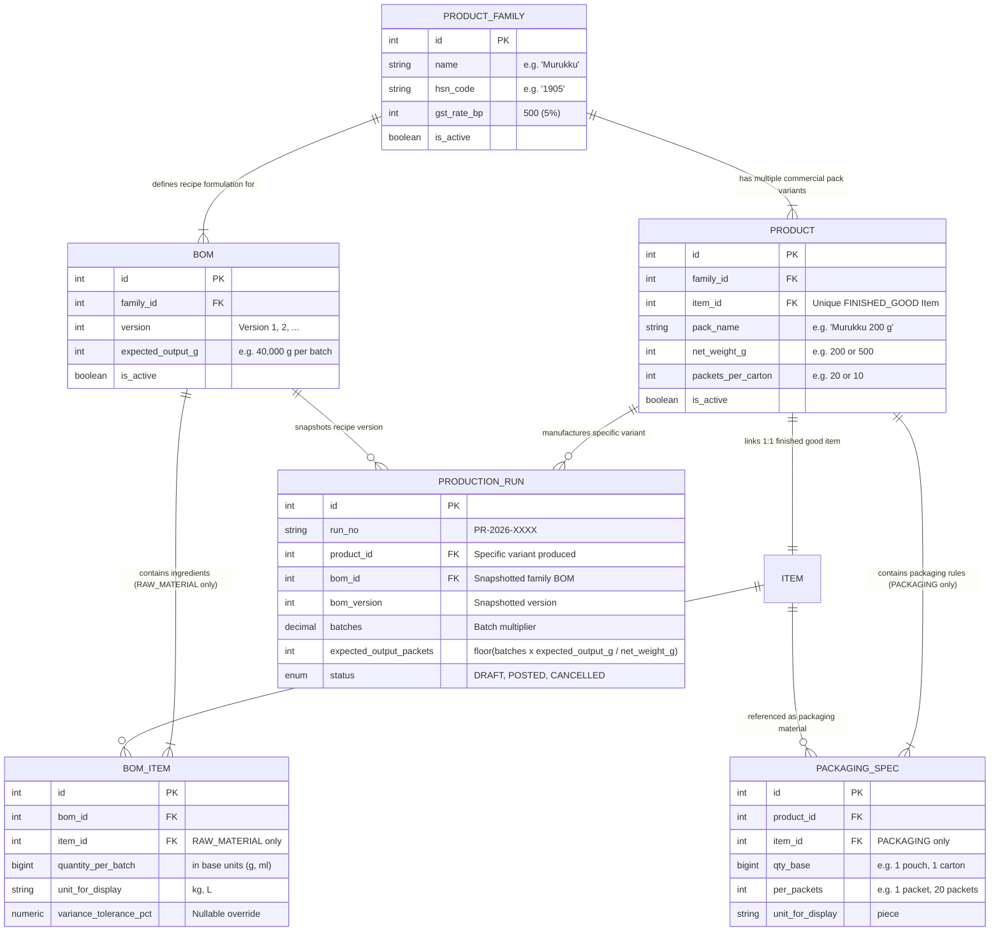
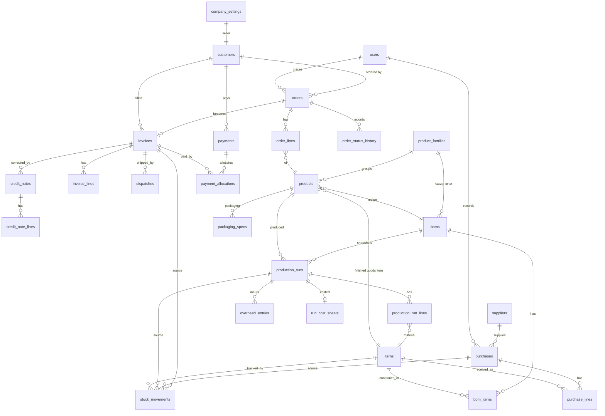

# Stock Ledger & Valuation Design Note

## 1. Why an Immutable Stock Ledger Beats a Mutable Balance Column

In traditional naive CRUD applications, inventory is often modeled as a mutable column:
```sql
-- The Naive Anti-Pattern
UPDATE items SET current_stock = current_stock - 10 WHERE id = 1;
```

While simple, this pattern is dangerous in manufacturing and enterprise accounting for several critical reasons:

### A. Total Loss of Provenance ("How Did We Get Here?")
A mutable column only tells you **what** the balance is right now. It cannot answer:
- Who altered the stock?
- Was a decrease caused by production usage, customer dispatch, theft, or spoilage?
- Which supplier invoice or production batch was responsible for an increase?

In our **Order-to-Audit** architecture, every single inventory change is an immutable entry in `stock_movements`. The current stock is strictly computed:
$$\text{Balance} = \sum \text{quantity\_base}$$

### B. Prevention of Race Conditions and Lost Updates
When two concurrent processes read `stock = 10` and both subtract `8`:
- With mutable updates without locking, both may write `stock = 2`, effectively issuing 16 units when only 10 were available (creating negative inventory).
- In our system, stock reductions strictly acquire a row-level write lock (`SELECT ... FOR UPDATE`) on the `Item` row, verify the aggregate balance from the ledger, and append an immutable signed negative movement. If requested > available, an `InsufficientStockError` (HTTP 409) is raised before any row is written.

### C. Point-in-Time Auditing ("As-Of" Queries)
Financial auditors and tax accountants regularly require inventory valuation as of a specific fiscal close (e.g. midnight March 31):
$$\text{Balance}(t) = \sum_{movement\_date \le t} \text{quantity\_base}$$
With an overwritten balance column, historical reconstruction is impossible without restoring database backups. With our ledger, point-in-time valuation is a native, deterministic SQL aggregation.

### D. Fraud Resistance & Tamper Proofing
Corrections are never made by modifying existing records. If an incorrect purchase was entered, a `CANCELLED` status triggers a reversing movement (`REVERSAL` with a pointer to `reverses_movement_id`). Both the mistake and the correction are permanently preserved in the ledger and the `audit_logs` table.

---

## 2. Moving Weighted Average Valuation Method

Inventory valuation uses the **Moving Weighted Average Cost** method.

### Method Specification:
1. **Receipts (Purchases, Openings, Production Output)**:
   When inventory is received, the per-base-unit cost is recorded with up to 6 decimal places (`Numeric(18, 6)` in paise per base unit) to avoid penny-rounding distortion on bulk purchases.
   $$\text{New Average Cost} = \frac{\text{Current Inventory Value} + \text{Receipt Value}}{\text{Current Quantity} + \text{Receipt Quantity}}$$
   
   *Example*:
   - Opening balance: 100 kg (100,000 g) flour @ Rs 42/kg (4.200000 paise/g) = Rs 4,200 (420,000 paise).
   - Purchase: 60 kg (60,000 g) flour @ Rs 45/kg (4.500000 paise/g) = Rs 2,700 (270,000 paise).
   - Total Quantity = 160,000 g.
   - Total Value = 690,000 paise.
   - New Moving Weighted Average Cost:
     $$\frac{690000 \text{ paise}}{160000 \text{ g}} = 4.312500 \text{ paise/g} = \text{Rs } 43.125\text{/kg}$$
   Stored with full 6-decimal-place precision (`Decimal("4.312500")`).

2. **Issues (Production Consumption, Sales Dispatch, Wastage)**:
   When stock is consumed or issued, it is valued at the current moving weighted average cost at the time of issue:
   $$\text{Issue Value} = \text{ROUND\_HALF\_UP}(\text{Quantity Issued} \times \text{Current Average Unit Cost})$$
   The unit cost of remaining inventory remains unchanged.

3. **Stock Adjustments**:
   Manual inventory adjustments (e.g. physical cycle count discrepancies) require an administrative reason and are valued at the prevailing weighted average cost.


---

## 3. Available-to-Promise (ATP) Inventory & Order Approval Protection

### The Core Problem: Why On-Hand Ledger Balance Alone Leads to Over-Commitment
In high-volume manufacturing and distribution, simply checking `current_stock >= requested` when approving sales orders is a dangerous flaw:
- Suppose current finished goods on hand = 100 packets.
- Salesman A submits Order 1 for 80 packets $\implies$ approved because $100 \ge 80$.
- Before Order 1 is physically dispatched from the warehouse, on-hand ledger balance remains 100 packets.
- If Salesman B submits Order 2 for 80 packets and the system only checks on-hand stock, it would also approve Order 2 ($100 \ge 80$), committing 160 packets against an inventory of only 100.
- When both trucks arrive at the dispatch bay, the warehouse faces an immediate stockout and customer fulfillment crisis.

### The Available-to-Promise (ATP) Rule
In our architecture, sales order verification strictly checks **Available-to-Promise (ATP)**:
$$\text{ATP}(\text{product}) = \text{Finished Goods Ledger Balance} - \sum_{\text{order.status} \in \{\text{APPROVED}, \text{INVOICED}\}} \text{quantity\_packets}$$

Where:
1. **Finished Goods Ledger Balance**:
   The exact, tamper-proof inventory balance derived from `stock_movements`:
   $$\text{Balance} = \sum \text{quantity\_base}$$
2. **Committed to Orders**:
   The sum of packet quantities across all active orders that have been promised/approved or invoiced, but have not yet been deducted from the ledger via a physical `DISPATCH` movement.
3. **Dispatch Reduction**:
   In Phase 6, when an order is dispatched, a `DISPATCH` stock movement decreases the ledger balance, and the order transitions to `DISPATCHED`. This seamlessly transfers the commitment from the order book to the physical ledger with zero double-counting or stock leaks.

### Concurrency Protection & Atomicity
To prevent race conditions where two administrators approve competing orders at the exact same millisecond:
1. The approval transaction strictly acquires an exclusive row-level write lock (`SELECT ... FOR UPDATE`) on the finished goods `Item` record.
2. Under this lock, the system recalculates the current ATP.
3. If $\text{requested} > \text{available}$, approval is blocked with an `HTTP 409 Conflict` response returning a structured shortage breakdown (`requested`, `on_hand`, `committed_elsewhere`, `available`, `shortage`).
4. Only if $\text{available} \ge \text{requested}$ (or if the admin explicitly passes `approve_with_shortage=true`) does the transaction transition the order status to `APPROVED`, atomically reserving the stock before releasing the row lock.

---

## 4. Product Costing, Overheads & Margin Engine

### A. Core Architecture & Design Decisions
1. **Material Valuation via Moving Weighted Average**:
   - Material cost is strictly determined from the immutable inventory ledger (`stock_movements`).
   - The material cost of a production run equals the exact sum of `value_paise` (absolute value) across all its `PRODUCTION_ISSUE` ledger movements.
   - Material cost is never recomputed from static item master rates or hypothetical price lists. Costing and inventory valuation always agree to the exact single paise.

2. **Separation of Factory Overheads & Ledger Immutability**:
   - Overheads (direct labour, gas, electricity/power, other manufacturing costs) are recorded in the dedicated `overhead_entries` table.
   - Overheads are **never written into the stock movements ledger**, keeping physical inventory quantities and procurement valuations purely tied to material flows.

3. **Cost Absorption Rule (Good Packets Absorb Wastage & Yield Loss)**:
   - Factory costs are absorbed by finished, marketable goods:
     $$\text{Cost Per Packet} = \frac{\text{Actual Material Cost} + \text{Allocated Overheads}}{\text{Actual GOOD Packets}}$$
   - If a batch expected 200 packets but yielded only 188 good packets (due to burnt pieces, defective sealing, or spillage), the 188 marketable packets bear the entire batch expenditure.
   - The financial impact of the shortfall is computed and highlighted separately as **Cost of Loss**:
     $$\text{Cost of Loss} = \text{Actual Material Cost} - (\text{Actual Good Packets} \times \text{Standard BOM Unit Material Cost})$$

4. **Overhead Allocation Rules**:
   - **Direct Overheads**: Entries assigned to a specific `production_run_id` are 100% charged to that run.
   - **Monthly Unassigned Overheads**: Monthly facility overheads (where `production_run_id` is `NULL`) are pooled by calendar month (`YYYY-MM`) and allocated across that month's `POSTED` production runs in direct proportion to good packets produced:
     $$\text{Run Share} = \left\lfloor \frac{\text{Monthly Overhead} \times \text{Run Good Packets}}{\sum_{\text{month}} \text{Good Packets}} \right\rfloor$$
     Any integer rounding remainder is distributed (1 paise each) to the runs with the largest shares, guaranteeing zero paise lost.

---

### B. Section 5 Benchmark Worked Example: Line-by-Line Rs 31.14 Calculation

#### Step 1: Flour Moving Weighted Average Valuation
- **Opening Stock**: 100 kg (100,000 g) @ Rs 42.00/kg (4.200000 paise/g) = Rs 4,200.00 (420,000 paise).
- **Purchase Receipt**: 60 kg (60,000 g) @ Rs 45.00/kg (4.500000 paise/g) = Rs 2,700.00 (270,000 paise).
- **Total Flour Inventory**: 160 kg (160,000 g) valued at Rs 6,900.00 (690,000 paise).
- **New Moving Weighted Average Cost (WAC)**:
  $$\frac{690,000 \text{ paise}}{160,000 \text{ g}} = 4.312500 \text{ paise/g} = \text{Rs } 43.125\text{/kg}$$

#### Step 2: Production Run Material Consumption (Ledger Issues)
1 batch of Murukku 200 g (expected yield: 200 packets):
| Item | Actual Quantity Consumed | Ledger Unit Cost | Line Cost (Paise) | Line Cost (Rupees) |
| :--- | :--- | :--- | :--- | :--- |
| **Flour** | 40 kg (40,000 g) | 4.312500 paise/g | 172,500 | Rs 1,725.00 |
| **Cooking Oil** | 10.5 L (10,500 ml) | 14.000000 paise/ml | 147,000 | Rs 1,470.00 |
| **Salt & Spice Mix** | 1.2 kg (1,200 g) | 20.000000 paise/g | 24,000 | Rs 240.00 |
| **200 g Pouches** | 194 pieces (188 good + 6 damaged) | 250.000000 paise/pc | 48,500 | Rs 485.00 |
| **Cartons** | 9 pieces | 1500.000000 paise/pc | 13,500 | Rs 135.00 |
| **Total Material Cost** | | | **405,500** | **Rs 4,055.00** |

#### Step 3: Direct Overheads
- Direct Labour: Rs 1,200.00 (120,000 paise)
- Gas & Power: Rs 600.00 (60,000 paise)
- **Total Overheads**: **Rs 1,800.00** (180,000 paise)

#### Step 4: Total Run Cost & Per-Packet Unit Cost
- **Total Production Run Cost**:
  $$\text{Material Cost} + \text{Overheads} = \text{Rs } 4,055.00 + \text{Rs } 1,800.00 = \text{Rs } 5,855.00 \text{ (585,500 paise)}$$
- **Actual Good Packets Produced**: 188 packets
- **Unit Cost Per Packet**:
  $$\frac{\text{Rs } 5,855.00}{188 \text{ packets}} = \text{Rs } 31.143617\dots \implies \mathbf{Rs\ 31.14} \text{ (3114.36 paise)}$$
- **Material-Only Cost Per Packet**:
  $$\frac{\text{Rs } 4,055.00}{188 \text{ packets}} = \text{Rs } 21.569148\dots \implies \mathbf{Rs\ 21.57} \text{ (2156.91 paise)}$$

#### Step 5: Commercial Margin vs Selling Price
- **Standard Selling Price** (from default Price List): **Rs 50.00** (5,000 paise, taxable value before GST).
- **Gross Margin Per Packet**:
  $$\text{Rs } 50.00 - \text{Rs } 31.143617\dots = \text{Rs } 18.85638\dots \implies \mathbf{Rs\ 18.86}$$
- **Gross Margin Percentage**:
  $$\frac{\text{Rs } 18.85638}{\text{Rs } 50.00} \times 100 = \mathbf{37.7\%}$$

#### Step 6: Planned Standard Cost & Cost of Loss
- **BOM Planned Consumption (200 packets)**:
  Flour 40 kg (172,500 paise) + Oil 10 L (140,000 paise) + Spice 1.2 kg (24,000 paise) + Pouches 200 (50,000 paise) + Cartons 10 (15,000 paise) = 401,500 paise (Rs 4,015.00).
- **Planned Standard Cost Per Packet**:
  $$\frac{\text{Rs } 4,015.00}{200 \text{ packets}} = \mathbf{Rs\ 20.075} \text{ (2007.5 paise)}$$
- Notice: Planned standard cost (Rs 20.08) is strictly lower than actual material cost (Rs 21.57) due to yield loss (188 vs 200 packets) and extra oil consumption (10.5 L vs 10 L).
- **Cost of Loss**:
  $$\text{Actual Material Cost} - (188 \times 2007.5 \text{ paise}) = 405,500 - 377,410 = \mathbf{28,090\text{ paise (Rs 280.90)}}$$

---

### C. Alternatives Considered: Why Moving Weighted Average Beats FIFO

During architecture design, **First-In, First-Out (FIFO)** was evaluated as an alternative valuation strategy:
- Under FIFO, the 40 kg flour consumed in this production run would be drawn entirely from the opening stock layer (100 kg @ Rs 42.00/kg), valuing flour at Rs 1,680.00 instead of Rs 1,725.00.
- This would have yielded a lower material cost of **Rs 4,010.00** instead of **Rs 4,055.00** for the run.
- **Why Weighted Average Was Chosen Over FIFO**:
  1. **Audit Simplicity & Stability**: In high-velocity batch food processing, raw materials (flour, oil, pulses) are physically co-mingled in storage silos and vats. Tracking individual purchase "layers" requires complex lot depletion pointers and introduces high computational overhead.
  2. **Elimination of Artificial Margin Volatility**: Under FIFO, two identical production batches run on the same morning can show sharply different margins simply because Batch 1 exhausted an older cheaper lot while Batch 2 began consuming a newer higher-cost delivery. Weighted average smoothly reflects economic input cost trends without artificial volatility.
  3. **Guaranteed Ledger Integrity**: Moving weighted average integrates directly with our append-only `stock_movements` ledger. Every issue records the exact prevailing average cost at that millisecond, enabling instant, deterministic point-in-time financial reporting without layer re-traversal.

---

## 8. How Pack Sizes Share a Bill of Materials (BOM)

### A. The Business Problem & Multi-Pack Architecture
In traditional food manufacturing, a single culinary formulation (e.g. "Murukku" dough made of flour, oil, and spices) is packaged into multiple commercial pack sizes—such as a 200 g retail pouch, a 500 g family pack, or a 1 kg wholesale bag.

A naive data model ties the recipe BOM directly to the finished commercial product variant. This causes severe operational anti-patterns:
1. **Recipe Duplication & Drift**: If oil ratio changes by +1%, every single pack size BOM must be individually updated. Missing even one pack size causes recipe divergence and quality inconsistency.
2. **Slow Variant Launches**: Introducing a new pack size requires duplicating the entire recipe, recalculating ingredient ratios manually, and risking human error during data entry.
3. **Improper Packaging Allocation**: Outer cartons and pouches depend on pack size, not the base culinary recipe.

### B. The Solution: Decoupled Family BOM & Variant Packaging Specs
We decoupled raw ingredient formulation from secondary packaging by introducing **ProductFamily** and **PackagingSpec**:



### C. Mathematical Derivations & Operational Rules

1. **Expected Finished Packets**:
   $$\text{expected\_packets} = \left\lfloor \frac{\text{batches} \times \text{expected\_output\_g}}{\text{net\_weight\_g}} \right\rfloor$$
   - *Benchmark (Murukku 200 g)*: $1 \times 40,000 / 200 = \mathbf{200\text{ packets}}$.
   - *500 g Variant (Murukku 500 g)*: $1 \times 40,000 / 500 = \mathbf{80\text{ packets}}$ using the **identical BOM**.

2. **Ingredient Planned Consumption (RAW_MATERIAL)**:
   $$\text{planned\_qty\_base} = \text{round}(\text{quantity\_per\_batch} \times \text{batches}, \text{ROUND\_HALF\_UP})$$
   - 1 Batch of 200 g: Flour 40 kg, Oil 10 L, Spice mix 1.2 kg.
   - 1 Batch of 500 g: Flour 40 kg, Oil 10 L, Spice mix 1.2 kg (**unchanged formulation**).

3. **Packaging Planned Consumption (The CEIL Rule)**:
   $$\text{planned\_packaging} = \left\lceil \frac{\text{expected\_packets} \times \text{qty\_base}}{\text{per\_packets}} \right\rceil$$
   *Why CEIL?*: You cannot consume a fractional carton or bag. If 21 packets are packed at 20 packets per carton, $\lceil 21 \times 1 / 20 \rceil = 2$ full cartons must be issued from inventory.
   - *Murukku 200 g (200 pkts)*:
     - Pouches: $\lceil 200 \times 1 / 1 \rceil = 200$ pouches
     - Cartons: $\lceil 200 \times 1 / 20 \rceil = 10$ cartons
   - *Murukku 500 g (80 pkts)*:
     - 500 g Pouches: $\lceil 80 \times 1 / 1 \rceil = 80$ pouches
     - Cartons: $\lceil 80 \times 1 / 10 \rceil = 8$ cartons

4. **BOM Immutability & Safe Versioning**:
   - A BOM that has been referenced by any `POSTED` production run is strictly immutable.
   - Saving changes automatically increments the version number ($v_1 \to v_2$), leaving the posted run permanently bound to $v_1$ snapshot.


---

## Data model (ER diagram)

Core entities and relationships. **Stock is derived** from `stock_movements`, never a mutable column. Money is integer **paise**. Business dates are **IST**; timestamps UTC.



Key tables: `items` (base_unit, display_unit, unit_conversion, reorder_level, hsn, gst), `stock_movements` (signed quantity_base, unit_cost, value_paise, source_type/source_id, reverses_movement_id, batch_no, expiry_date), `boms`/`bom_items` (qty per batch, tolerance, version), `products` + `product_families` + `packaging_specs`, `production_runs`/`production_run_lines`, `overhead_entries`, `run_cost_sheets`, `orders`/`order_lines`/`order_status_history`, `invoices`/`invoice_lines`, `dispatches`, `credit_notes`, `payments`/`payment_allocations`, `audit_log`. See `backend/app/models/`.
